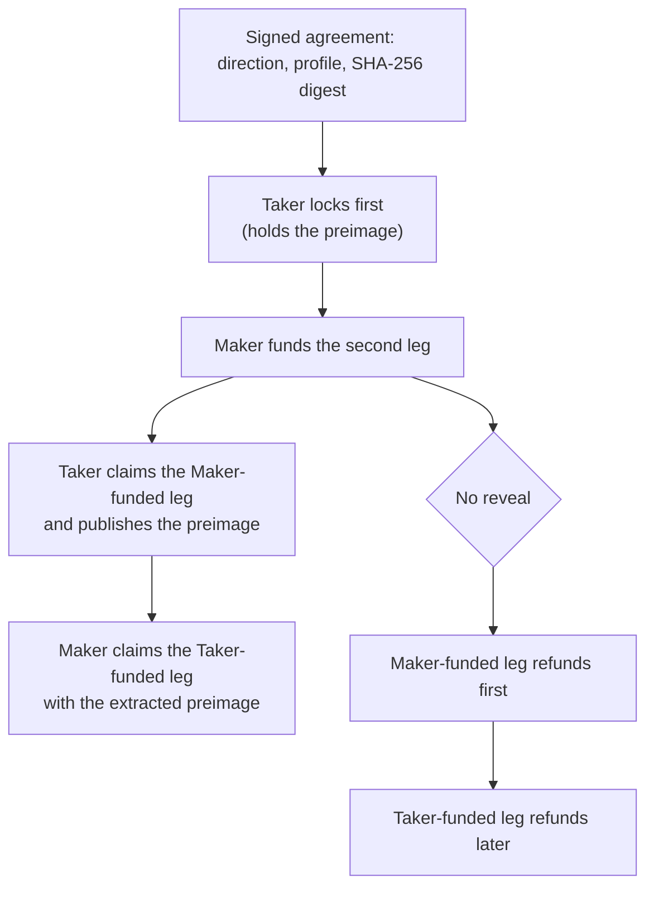

# ADR 0216 — ZEC follows the common flow: the Taker reveals first in both directions

Status: Accepted, 2026-11-18. Supersedes the ZEC claim and refund order of
[ADR 0008](0008-bidirectional-role-ordering.md); the rest of ADR 0008
(direction as signed data, XMR `TakerSellsLez` only, role-relative funding)
stands. Threat-model delta: new threat TM-0030 (the Maker claims the
Taker's LEZ without funding Zcash) and a rewritten INV-07; recorded below.

## Context

AGENTS.md, "Protocol design": for a given direction, who locks first, who
holds the secret, who claims first and which refund matures first are the
same for every pair; a pair differs only in the mechanism that carries the
secret.

ADR 0008 fixed the ZEC order by chain instead: in both directions the LEZ
recipient held the preimage and claimed LEZ first, and the LEZ refund was the
earlier one, as RFP-003 F4 reads ("the Zcash refund deadline must strictly
succeed the LEZ refund deadline"). In `TakerSellsForeign` that is the common
flow, because the LEZ recipient is the first-locking Taker. In
`TakerSellsLez` it is not, and it is unsafe:

- the Taker locks LEZ first with the Maker as claimant and
  `SHA256(preimage)` as the hashlock;
- the Maker, as LEZ recipient, held the preimage from the start;
- the escrow's `claim_native` checks the claimant's signature, the preimage
  against the digest and the validity window, and nothing about the Zcash
  leg (LEZ cannot observe Zcash).

So a Maker could claim the Taker's LEZ as soon as the Taker locked, without
ever funding the Zcash HTLC. Nothing in the protocol stopped it; only the
Maker's own software chose to fund first. BTC `TakerSellsLez` does not have
this flaw: its LEZ claim needs an adaptor witness that only the Taker's
Bitcoin claim reveals.

## Decision

One rule for BTC and ZEC in both directions: the Taker locks first, holds the
secret, claims the Maker-funded leg first; the Maker-funded leg refunds first.

| Pair / direction | First lock | Secret holder | First claim (reveals) | Earlier refund |
|---|---|---|---|---|
| BTC `TakerSellsForeign` | Taker (BTC) | Taker (adaptor secret) | Taker claims the Maker-funded LEZ | Maker's LEZ |
| ZEC `TakerSellsForeign` | Taker (ZEC) | Taker (preimage) | Taker claims the Maker-funded LEZ | Maker's LEZ |
| BTC `TakerSellsLez` | Taker (LEZ) | Taker (adaptor secret) | Taker claims the Maker-funded BTC | Maker's BTC |
| ZEC `TakerSellsLez` | Taker (LEZ) | Taker (preimage) | Taker claims the Maker-funded ZEC | Maker's ZEC |

ZEC `TakerSellsForeign` already followed this rule and does not change; BTC
does not change. XMR does not follow the rule: its only direction
(`TakerSellsLez`) keeps the reviewed COMIT order, in which the Maker claims
LEZ first. That claim needs the Taker's Tag 14 authorization, which the Taker
publishes only after the Monero funding is confirmed, so the flaw above does
not apply to it; this ADR does not change XMR.

In swap-core, `first_claimant()` is the Taker for Bitcoin and Zcash, and the
Zcash safety order is the Maker's refund chain, then the Taker's, as for
Bitcoin. In ZEC `TakerSellsLez`:

1. The per-swap preparation generates the preimage and gives it to the
   Taker's half only. The Maker's agreement and template carry the digest
   alone; `activate_with_claim_preimage` is refused for the Maker in both
   directions.
2. The Taker locks LEZ (claimant Maker, hashlock the digest). The Maker funds
   the Zcash HTLC (claimant Taker, refund Maker) only while
   `tip + reveal margin + confirmations < Zcash refund height` and
   `now < LEZ refund time − margin`.
3. The Taker claims ZEC with the preimage (claim step `RevealingZcash`) only
   when the Maker's funding is canonical, unspent and at the profile's Zcash
   depth, `tip + zcash_reveal_margin_blocks < Zcash refund height`, and
   `now < LEZ refund time − margin`. Otherwise the SDK returns
   `ZcashRevealWindowClosed` or `ClaimWindowClosed`, no claim is sent, and
   the Taker's next action is its LEZ refund (`RefundLez`) at the LEZ refund
   time. A claim already submitted is followed to the end.
4. The Maker observes the spend of its exact HTLC outpoint
   (`ZcashClaimPort::observe_counterparty_revealing_claim`), extracts the
   preimage on first sight (in the mempool or a block, on consensus facts
   only), checks it against the digest and commits it with the observed
   transition; it then claims LEZ (`FollowupLez`).
5. Refunds: the Maker's Zcash refund at the Zcash refund height is the
   earlier; the Taker's LEZ refund at the LEZ refund time is the later. In
   `BothLegsLocked` each role drives its own refund (the Taker cannot sign the
   Zcash refund, so its LEZ refund does not wait for it). The Maker is offered
   its Zcash refund as soon as the Zcash tip reaches the refund height (its
   drive records the tip), between `H_z` and `T_lez − M`, and keeps reading
   the HTLC for a late Taker claim until its refund is mined. A Taker whose
   own claim was lost to that refund records the Maker's refund and refunds
   its LEZ. No refund is admitted once claim evidence is recorded.
6. The HTLC of the Taker-reveals-first profiles checks `OP_SIZE 32` on the
   claim branch: a claim with a preimage of any other length is invalid on
   Zcash, so the Taker cannot take the ZEC with a secret the LEZ escrow
   cannot accept. The older profiles' script is unchanged byte for byte.

### Deviation from RFP-003 F4

In `TakerSellsLez`, F4 and "the Taker locks first" cannot both hold safely:
with the LEZ refund first, the Zcash funder must be the last to be able to
claim, so the Maker would have to hold the preimage while the Taker's LEZ is
already locked — the flaw above. We keep the Taker locking first and the
common flow, and deviate from F4 in `TakerSellsLez` only: there the Maker's
Zcash refund matures first and the Taker's LEZ refund later.
`TakerSellsForeign` still satisfies F4.

### Timing

With `A` the signed LEZ anchor, `T_lez = A + lez_refund_delay`, `h0` the
signed Zcash anchor height, `H_z = h0 + zcash_refund_blocks`, `M` the
required margin and `slow` the slowest Zcash pace the profile is sized for:

- order: the latest wall time of `H_z`, plus `M`, is at most `T_lez`. The
  refund plan signs it as `earlier_refund_latest_ms` (Zcash) and
  `later_refund_earliest_unix_seconds = T_lez`;
- public profiles: `earlier_refund_latest_ms >= A + (N + 1) × slow` (the
  anchor is the tip plus one at agreement time); on Regtest the harness mines
  every block and the provisioner declares `T_lez − M`;
- the Maker's follow-up: the Maker reads a Taker claim on first sight, so a
  claim broadcast as late as the Maker's refund at `H_z` leaves the Maker `M`
  for its LEZ claim's inclusion (plus its place in the Node's LEZ claim queue).

### Profiles and versioning

The profile id is in the signed body, so it versions the meaning. Four new
immutable profiles carry the Taker-reveals-first order
([parameter profiles](../milestone-1/parameter-profiles.md)):
`deterministic-local-v3` (wire tag 10), `deterministic-local-devnet-v7` (11),
`deterministic-local-devnet-v8` (12) and `public-testnet-v3` (13). The older
profiles (tags 0–9) keep their parameters and admit `TakerSellsForeign` only;
`TakerSellsLez` under one of them is refused with
`ZecAgreementV1Error::LegacyRevealOrder`. The wire schema stays
`ZEC_CONCRETE_AGREEMENT_SCHEMA_V2`: its label is not covered by the
signature, so it cannot carry meaning safely. A Node built before this ADR
decodes tags 10–13 as a malformed record and refuses them; a Node built after
it refuses `TakerSellsLez` under a legacy profile. Every pairing of old and
new Nodes therefore refuses the unsafe terms, and `TakerSellsForeign` under
the legacy profiles still interoperates. `ZecRefundPlanV1` keeps its four
fields and byte layout; its third field is named `earlier_refund_latest_ms`
and means the earlier refund's latest wall time on whichever chain refunds
first.

The provisioner signs `TakerSellsLez` under `deterministic-local-devnet-v7`
(claims), `deterministic-local-devnet-v8` (refund journeys) and
`public-testnet-v3`, and keeps `TakerSellsForeign` on
`deterministic-local-devnet-v5`/`-v6` and `public-testnet-v2`, so that
direction's agreements are byte-identical to those signed before.

## Consequences

- Known limit of `public-testnet-v3`: the Maker funds Zcash only once the Taker's LEZ lock has `lez_confirmations` (2) and, on the LEZ v0.2 testnet (`PublicTestnetV0_2`), is finalized (`classify_unchanged_lez_maker_eligibility`). LEZ testnet finality has been recorded at one to two hours, while the Maker must fund while `tip + R + C < H_z`, about 74 Zcash blocks (roughly 28 minutes at Testnet's measured pace) after the anchor, and the pace check refuses funding that late as well. As sized, the profile therefore never reaches Zcash funding on the public networks; no public-network run is claimed for it, and it is not retuned without measurements of LEZ testnet finality and claim latency.
- Refunding from the Zcash refund height shortens how long an unmined Taker
  claim is tolerated: a claim not mined by then can lose the race to the
  Maker's refund. The Taker's protection is its reveal margin (it claims only
  while `tip + R < H_z`) and its claim having no expiry (it is re-broadcast
  byte for byte while the HTLC is unspent). On the Regtest and devnet profiles
  (one Zcash confirmation) a one-block reorg of the Maker's refund could leave
  the Taker with both legs; those profiles serve harness chains only.
- A Maker whose LEZ claim was lost (the Taker's claim never mined, the
  Taker's LEZ refund final) recovers its Zcash while the HTLC is unspent at
  its refund height; with the HTLC spent by the Taker's claim at the
  profile's Zcash depth it stops as `lez_claim_cannot_land`. A spend in the
  mempool only is a wait: the Taker's claim never expires but can be
  evicted, which leaves the HTLC unspent again. The Maker gives up its LEZ claim only on the
  escrow being refunded, never on its own clock: the escrow's claim window
  ends at `refund_at` by the sequencer's block time. Once the finalized LEZ
  block time is at or past `refund_at` it submits the claim no more and only
  observes it (it may have landed earlier); the swap stays at its claim,
  holding no other claim and counted by no capacity, reported as waiting
  for the Taker's LEZ refund (`taker_lez_refund_after_lost_claim`), and
  re-plans exhausted past `refund_at` do not stop it.

- The Maker reads the preimage from any consensus-valid claim of the HTLC
  (the claim branch of this contract with a 32-byte preimage of the digest),
  not only from claims in the SDK's template, and commits it on first sight,
  mempool included, so a Taker cannot keep the preimage from the Maker by
  claiming with another destination, fee, expiry or sighash, and the
  Maker's margin is not spent waiting for depth. The Taker re-broadcasts a
  staged claim whatever the window, since its preimage may already be
  public.
- The Maker's LEZ claims go one at a time on its one LEZ account, the
  earliest LEZ refund first, and the number of open `TakerSellsLez` ZEC
  swaps a Maker accepts is capped so that the queue fits in the margin
  (3 under the devnet profiles, 1 under `deterministic-local-v3` and
  `public-testnet-v3`; [SDK guide](../sdk-lez-zec.md)). The Maker funds
  Zcash only while the claim window is open, `tip + R + C < H_z`, and, under
  a profile with a slowest pace (`public-testnet-v3`), `H_z` can still be
  reached before `T_lez − M` at that pace: `(H_z − tip) × slow ≤ T_lez − M − now`.
  `public-testnet-v3` is sized with no slack at the anchor, so a Testnet slower
  than 75 s a block in the first minutes makes the Maker decline to fund.
- A Node refuses to start while it holds an open `TakerSellsLez` swap under a
  legacy profile (issue #133: drain before upgrading).

- At the Node boundary the Maker never holds the preimage before the
  Taker's Zcash claim is seen: its store has no claim material and no claim
  intent after the Taker's lock or after its own funding, the first preimage
  it stores is the one read from the Taker's claim, and the Maker's Node and
  actor refuse material that carries one. The prepared ZEC setup is single-operator: the preparation ceremony (`zec-provision.sh`, `local_poc.rs`) signs the template agreement with both roles' keys and holds both halves, the preimage included, while it runs. It is safe only where the preparer is trusted by the Taker (a devnet, a Testnet acceptance run by one owner). Node-side take-time preparation, in which the Taker's Node creates the secret and each Node its own Zcash key, is tracked in issue #162 for M5.
- The LEZ escrow program is unchanged (ImageID unchanged). It still pays
  whoever signs as the stored claimant and presents the preimage; safety in
  `TakerSellsLez` rests on the first locker holding the secret, as it does in
  `TakerSellsForeign`.
- `ZecLifecycleAction` gains `RefundLez`. In `TakerSellsLez` the Taker's
  action at `BothLegsLocked` is `ClaimZcash` and the Maker's at
  `ClaimEvidenceAvailable` is `ClaimLez`. The actor and Node wire keeps
  `claim_lez`/`claim_zcash` meaning the chain claimed, and adds `refund_lez`
  and the claim operations `zcash_revealing_claim` and `lez_followup_claim`.
- The Maker Node's one-LEZ-claim-in-flight gate covers the Maker's follow-up
  LEZ claim, as it covered its revealing claim before. A submitted claim's
  in-flight marker holds the others until its swap's LEZ refund time, or
  until its actor removes it (the claim final, or unable to land). A swap
  stopped as failed is driven no more, so its marker holds for one
  admission bound after the failure and is then ignored: a claim it left
  pending costs the next claim one re-plan at the nonce, never funds. The
  Node reads no LEZ account nonce, so it cannot release the hold the moment
  that claim lands.
- A `TakerSellsLez` swap stored by a Node built before this ADR cannot be
  resumed: its agreement names a legacy profile and is refused.
- The Taker must claim ZEC while the Zcash refund is at least
  `zcash_reveal_margin_blocks` away and the LEZ refund at least `M` away; a
  Taker that misses that window refunds its LEZ.
- The secret is still created by the per-swap preparation, not by a Node.
  Generating it in the Taker Node at take time would need the Maker to accept
  a Taker-chosen digest outside its signed template, which this ADR does not
  do.

## Threat-model delta

- New TM-0030: the Maker claims the Taker's LEZ in `TakerSellsLez` without
  funding Zcash. Control: the Taker holds the preimage and reveals it only by
  claiming the Maker-funded, confirmed Zcash output. Residual risk: if Zcash
  runs slower than the profile's slowest pace (a Testnet stall), `H_z` can fall
  after `T_lez − M` and a dishonest Taker can claim ZEC late and also refund
  LEZ; this mirrors `TakerSellsForeign`'s dependence on the fastest pace, and
  BTC `TakerSellsLez` has the same dependence. The BIP-199 claim branch has
  no deadline, so a Maker offline at its refund time stays exposed: a Taker
  can still claim ZEC after `H_z`, and if the Maker does not follow with its
  LEZ claim before `T_lez`, the Taker also refunds LEZ. The Maker must be
  online between `H_z` and `T_lez − M` to refund Zcash or to follow a claim.
- INV-07 now states one recovery order for BTC and ZEC: the Maker-funded leg
  refunds first; the Taker claims the Maker-funded leg first.

## Evidence

Passed under `cargo test` on 2026-11-18:

- `crates/swap-core/tests/zec_contract_ordering.rs`:
  `zec_taker_always_reveals_first_on_the_maker_funded_leg_which_refunds_first`,
  `zec_schedule_rejects_a_taker_funded_leg_that_refunds_first`;
- `crates/zec-swap-sdk/src/sdk.rs` unit tests:
  `taker_sells_lez_refunds_follow_the_earlier_zcash_refund_either_way`,
  `each_funder_is_offered_its_refund_step_in_a_reorg_phase_without_claim_evidence`.

Not run yet: the Node matrix on the Docker devnet under
`deterministic-local-devnet-v7`/`-v8` (zec-happy, zec-maker-refund,
zec-taker-refund, the restart, concurrency and catalog scenarios in
`TakerSellsLez`), the desk journeys, the BTC regression on the same commit,
and a public Testnet corridor under `public-testnet-v3`. The M2 regression of
2026-11-11 ran `TakerSellsLez` under the order this ADR replaces and is not
evidence for it.
