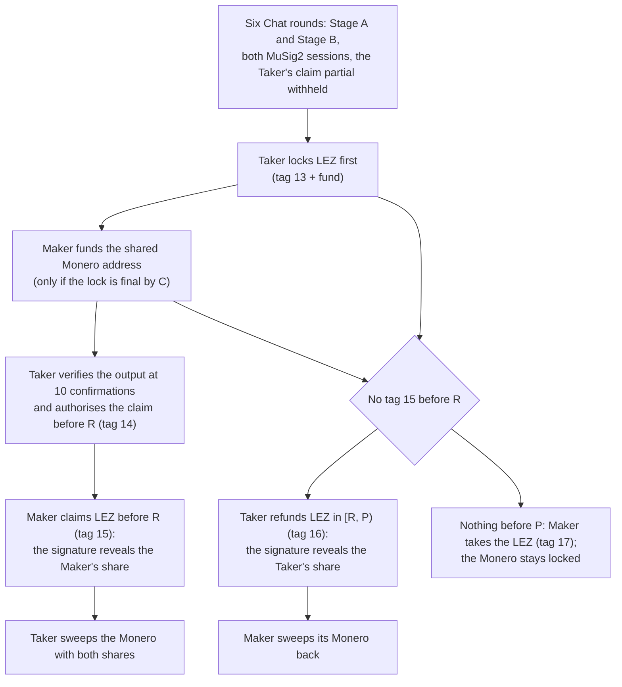

# ADR 0217 — XMR selling LEZ keeps its own order, an exception to the common flow

Status: Accepted, 2026-11-21 (proposed 2026-11-20). Relates to issue #161 (the XMR leg, RFP-003 M4)
and to [ADR 0216](0216-zec-taker-reveals-first-in-both-directions.md), which
fixes the common flow for BTC and ZEC and leaves XMR as it is. It changes no
code, no escrow instruction and no profile. Threat-model delta: TM-0031, the
unfunded punishment; see below.

## Context

AGENTS.md, "Protocol design": for a given direction, who locks first, who
holds the secret, who claims first and which refund matures first are the same
for every pair; a pair may differ only in the mechanism that carries the
secret; a pair that cannot follow the common flow in a direction does not offer
that direction. Before this ADR it also said that XMR did not follow the rule
and that aligning it, or withdrawing the direction, was part of issue #161.
This ADR settles that: AGENTS.md now names XMR `TakerSellsLez` as the one
accepted exception and points here.

### The common flow for "Taker sells LEZ"

ADR 0216's Decision table fixes it for BTC and ZEC:

1. **Locks first:** the Taker, on LEZ.
2. **Holds the secret:** the Taker (the BTC adaptor secret, the ZEC preimage).
3. **Claims first:** the Taker, the Maker-funded foreign leg; that claim
   reveals the secret, with which the Maker then claims the Taker's LEZ.
4. **Earlier refund:** the Maker's foreign leg; the Taker's LEZ refund matures
   later.

The point of facts 2 and 3 is ADR 0216's TM-0030: the LEZ escrow cannot see the
foreign chain, so if the Maker held the secret it could claim the Taker's LEZ
without funding the foreign leg. The common flow closes that by giving the
secret to the party whose LEZ is locked.

### What a Monero output can enforce

A Monero output has no script. It carries no hash lock and no time lock, and
whoever knows its spend key can spend it, at any time. For any LEZ/XMR swap it
follows that:

- the Monero leg's "lock" is a 2-of-2 key split: the Maker pays to an address
  whose public spend key is the sum of an Ed25519 share from each role
  (`MoneroSharedAddressV1`, `crates/xmr-swap-sdk/src/shared_spend.rs`), and
  neither role can spend it alone;
- the Monero leg's "claim" is learning the other role's share: whoever learns
  it adds its own and holds the full spend key (`ReconstructedMoneroSpendKey`,
  which checks the sum opens the agreed address);
- the Monero leg has no refund of its own. The Maker gets its Monero back only
  by learning the Taker's share; a refund by time would need a Monero
  transaction pre-signed before funding, which this project does not have.

Every condition and every deadline therefore lives on LEZ, and every share is
revealed there: the construction ([protocol design](../milestone-1/protocol-design.md#xmrlez))
has two secp256k1 MuSig2 adaptor sessions on LEZ, each with a role's Monero
share as adaptor secret, and a cross-curve DLEQ proof per share binding the
secp256k1 adaptor point to the Ed25519 share point
(`crates/xmr-swap-sdk/src/cross_curve.rs`). In
`crates/xmr-swap-sdk/src/agreement_v1.rs` the claim session's adaptor point is
the Maker's proof's secp256k1 key and the refund session's is the Taker's.

## The flow as built

The escrow tags are those of `compat/lez-v0.2-provisional/escrow/src/lib.rs`;
the windows C (the Maker's funding cutoff), R (refund time) and P (punish time)
are fixed in Stage A (`XmrWindowsV1`). R and P are in the escrow and checked
against LEZ block time; C is not on chain.

1. **Agreement.** Six Chat rounds produce the dual-signed Stage A and Stage B
   and run both MuSig2 sessions. The Taker withholds its claim partial: Stage B
   and the escrow carry only a commitment to it. Both roles hold the refund
   pre-signature; the Taker also holds the claim pre-signature's inputs (its
   own partial and the Maker's).
2. **Taker locks LEZ (tag 13, then the native fund).** `InitializeNativeXmr`
   is signed by the Taker's owner account and is valid before R. It stores
   both aggregate keys and the account ids derived from them, the two DLEQ
   transcript commitments, the claim-partial context binding and commitment, R
   and P. The guest checks that the commitments are nonzero and distinct; it
   verifies no DLEQ proof and no Ed25519 value.
3. **Maker funds Monero, before C.** The Maker actor
   (`crates/maker-node/src/bin/xmr-maker-actor.rs`, `drive_once`) funds once,
   only after it has seen the Taker's lock final, only while the finalized LEZ
   clock is before C, and a lock final after C ends the swap `expired`
   (`derive_status`).
4. **Taker verifies and authorises, before R (tag 14).** The Taker Node
   (`crates/taker-node/src/taker_service/xmr_supervisor.rs`) finds the exact
   amount at the shared address through a view-only wallet and records it only
   when `MoneroOutputVerifier::verify` passes (10 confirmations,
   `REQUIRED_MONERO_CONFIRMATIONS`). `ensure_claim_authorizable` admits tag 14
   only on the owner's claim, with the escrow funded at or before C, the Monero
   output recorded, no refund sent, and the Taker's clock before R.
   `AuthorizeNativeXmrClaim` is signed by the Taker's owner account, publishes
   the 32-byte claim partial, and is accepted only from `Funded`, only if
   SHA-256 of the domain, the context binding and the partial equals the
   stored commitment, and only before R; it moves the escrow to
   `XmrClaimAuthorized`.
5. **Maker claims LEZ, before R (tag 15).** The Maker activates its claim only
   on a tag 14 it sees final while the finalized LEZ clock is before its claim
   deadline R − (R − C)/2 (`Facts::claim_deadline_ms`). It aggregates the
   claim pre-signature with the published partial and completes it with its
   Monero share. `ClaimNativeXmr` is signed by the claim aggregate authority
   account, is accepted only from `XmrClaimAuthorized` and only before R, and
   pays the Maker. The completed signature, against the claim pre-signature
   the Taker holds, gives the Taker the Maker's share (`maker_claim_key`: the
   extracted secret is checked against the Maker's DLEQ proof and, with the
   Taker's share, must open the shared address).
6. **Taker sweeps the Monero.** No deadline applies; the Taker Node watches
   for tag 15 also after R and P (`settle_step`), since a tag 15 final before R
   may be seen later.
7. **Taker refunds LEZ, in [R, P) (tag 16).** The Taker Node refunds by
   itself, on every funded escrow the Maker has not claimed, with no owner's
   command (`refund_runs`; `initiation.xmr_automatic_refund: false` leaves it
   to the owner's refund, which is offered either way). It
   completes the refund pre-signature with its own share (`refund_signature`)
   and submits it once the finalized LEZ time is at or past R (`refund_step`):
   LEZ admits a transaction whose window is not open and drops it at block
   building, so the Taker's own clock does not decide. A refund not yet final
   is sent again, the same bytes, on every supervisor tick while the
   finalized LEZ time is before P; the sidecar decides each such submission
   on the chain (already known once included, sent again otherwise). Past P a
   refund that is not final reads `xmr_refund_not_final_by_punish_time`.
   Before it completes or sends the refund the Node reads the escrow at the
   sequencer tip, beyond what is final (`observe_native_xmr_escrow_tip`): a
   Maker's claim there holds the refund back for good, and the Monero is
   swept once the claim is final. A refund sent after tag 15 landed would
   fail on chain but hand the Maker the Taker's share while it holds its own,
   and both would race for the Monero.
   `RefundNativeXmr` is signed by the refund aggregate authority account, is
   accepted from `Funded` or `XmrClaimAuthorized`, only in [R, P), and pays
   the Taker. The completed signature gives the Maker the Taker's share, and
   the Maker sweeps its Monero back. The generic `refund_native` instruction
   refuses an XMR escrow, so no refund avoids this reveal.
8. **Maker punishes, from P (tag 17).** `PunishNativeXmr` is signed by the
   Maker's owner account, is accepted from `Funded` or `XmrClaimAuthorized`,
   only from P, and pays the Maker. It reveals no share: the Monero stays at
   the shared address for good. The reference Maker activates the punishment
   only for a swap whose funding it invoked, with the finalized clock past P
   and no tag 16 found to the finalized tip. Tag 17 has no upper window and
   nothing else moves the escrow after P, so the punishment is driven until
   it is final: sent again while the node has not included it, and re-planned
   at the live nonce whenever another transaction of the owner took its own,
   for as long as that happens (`MAX_XMR_PUNISH_REPLANS` only keeps the
   lineage finite).

Tags 15 and 16 are exclusive: tag 15 ends at R, tag 16 starts there, and each
moves the escrow out of the state the other needs. The escrow test
`xmr_native_claim_refund_and_punish_are_atomic_and_disjoint` checks the
windows, and that tag 15 fails before tag 14.

## The four facts compared

| Fact | Common flow, `TakerSellsLez` (BTC, ZEC) | XMR `TakerSellsLez` | Same? |
|---|---|---|---|
| Locks first | Taker, LEZ | Taker, LEZ (tag 13 and the fund) | Yes |
| Holds the secret | Taker: the secret that completes the swap | Maker: its Monero share, the claim session's adaptor secret, completes the swap. The Taker holds a gate instead: its withheld claim partial, without which no tag 15 exists | No |
| Claims first | Taker, the Maker-funded foreign leg; its claim reveals the secret | Maker, the Taker-funded LEZ (tag 15), only after the Taker's tag 14; its claim reveals the Maker's share | No |
| Earlier refund | Maker's foreign leg; the Taker's LEZ later | Taker's LEZ (tag 16 from R), the only refund on any chain; the Maker's Monero comes back only through the share tag 16 reveals | No |

Three of the four facts differ. Each difference follows from the Monero output
having no script (argument):

- **Secret and first claim.** The Taker can take the Monero only by learning
  the Maker's share, and only LEZ can reveal a share against a condition. The
  Maker reveals it only in exchange for the Taker's LEZ, so the Maker's LEZ
  claim must be what reveals it: the Maker holds the completing secret and
  claims first. A Taker that claimed first would be claiming the Monero, which
  it cannot spend before the Maker has revealed.
- **Refund order.** A Monero refund that matures first would need a time lock
  on Monero. The Maker's Monero can come back only by the Maker learning the
  Taker's share, and the Taker reveals it only in exchange for its own LEZ, so
  the Taker's LEZ refund is the refund, and the Maker's recovery follows it.

One further difference lies outside the four facts: in BTC and ZEC the Taker's
LEZ refund, once open, has no end; here it is open only in [R, P), because the
punishment from P is what keeps a Taker that disappears from holding the
Maker's Monero locked at no cost.

## Why each party is safe

Every abort point, from the code above:

| Where it stops | Taker | Maker | Covered by |
|---|---|---|---|
| Before the Taker's lock | nothing at stake | nothing at stake; the reservation lapses after 900 s | — |
| Taker locked; Maker never funds, or the lock is final after C | its Node refunds LEZ with tag 16 from R by itself, or on the owner's refund; a lock it has not seen final by C (it was down, its scan lagged, a submission's answer was lost) it keeps looking for until it is found or the finalized LEZ time reaches R with the escrow empty | nothing at stake; its actor ends `expired`; the share tag 16 reveals opens an empty address | `xmr-maker-never-funds` (passed at `d4475300` with the owner's refund; since rewritten for the Node's own refund: the Maker Node is kept down until the Taker Node has refunded from R with no command, which passed at `7b4e46da`); the refund by itself: unit test `the_node_refunds_by_itself_from_r_without_an_owner_command`; a lock seen late: `a_lock_final_before_c_and_seen_after_c_is_found`, `a_lock_final_after_c_is_found_and_refunded_from_r`, `a_lost_submit_answer_does_not_stop_the_look_for_the_lock` |
| Maker funded; Taker never authorises | its Node refunds LEZ with tag 16 from R by itself, or on the owner's refund | sweeps its Monero back with the revealed share | `xmr-taker-refund`, `xmr-taker-refund-kill` (owner's refund) |
| Taker's refund sent and dropped (its clock ahead of LEZ time, or lost by the sequencer) | sends nothing before the finalized LEZ time reaches R, then sends the same tag 16 again on every tick until it is final or LEZ time reaches P | sweeps its Monero back once tag 16 is final; punishes only with no tag 16 to the finalized tip from P | unit tests: `a_refund_accepted_and_never_included_is_sent_again_until_it_lands`, `a_host_clock_ahead_of_lez_time_does_not_send_the_refund_early`, `a_refund_not_final_at_p_says_so` (Taker supervisor), `tag16_not_included_is_sent_again_until_it_lands` (sidecar); devnet: `xmr-taker-clock-ahead` (the Taker's clock 60 s ahead; no refund recorded as sent before the finalized LEZ time reaches R) |
| Taker authorised (tag 14); Maker does not claim by its deadline | from R the escrow refunds from `XmrClaimAuthorized`; the Node shows `xmr_maker_did_not_claim` with `refund`; refunds with tag 16 | sweeps its Monero back with the revealed share; a Maker that claims later than its own deadline but before R gives the Taker the share instead | unit tests: `a_late_claim_authorization_is_left_to_the_takers_refund` (Maker actor), `the_claim_path_reads_in_the_status_table` (Taker supervisor); no devnet scenario holds the Maker there |
| Maker claimed (tag 15), also when the claim is at the sequencer tip and not yet final | has the Maker's share; sweeps whenever it is back, no deadline; sends no refund, by itself or on command | has the LEZ | `xmr-happy`, `xmr-concurrent`, `xmr-kill-taker` (7 kill points, among them "waiting for the Maker's claim" and "sweeping"); unit tests `after_the_makers_claim_the_node_sweeps_and_never_refunds`, `a_maker_claim_at_the_tip_holds_the_refund_back` (Taker supervisor), `the_escrow_is_read_at_the_sequencer_tip` (sidecar) |
| Taker Node down through [R, P), Maker funded | loses its LEZ | takes the LEZ with tag 17, re-planned past any number of taken nonces; its Monero stays locked | `xmr-punish`; re-plans and resends: unit test `a_punishment_replanned_more_than_five_times_still_lands` (sidecar); devnet: `xmr-punish-replans` (the punishment's nonce taken six times; it lands) |

Crash and restart at each step are covered by `xmr-kill-taker`,
`xmr-kill-maker` (6 kill points) and `xmr-taker-refund-kill`. The scenarios
named here passed in the full regression at `7b4e46da`
([regression-0.4.0-2026-11-22-macos-arm64](../evidence/regression-0.4.0-2026-11-22-macos-arm64/results.tsv)),
each on its first try, on the Docker devnet against Monero regtest, arm64;
all but those added after it (`xmr-taker-clock-ahead`, `xmr-punish-replans`
and the four below) also passed in the full regression at
`d4475300`
([regression-m4-2026-11-21](../evidence/regression-m4-2026-11-21/results.tsv)),
on the Docker devnet against Monero regtest. That run predates the Taker
Node's own refund from R and its re-sent refund (`21fbc900`, `071f907e`), so
in it every Taker refund was the owner's. The devnet scenarios that check the
rules of this ADR against a cheating party, `xmr-maker-claim-without-authorization`
(tag 15 with no tag 14 and no Monero: refused), `xmr-maker-early-punish`
(tag 17 before P, and after the Taker's refund: refused),
`xmr-unfunded-punish` (TM-0031 with the Taker Node stopped and running) and
`xmr-taker-cheats` (tag 16 before R, and after tag 15: refused), are in the
full tier (`regress.sh` ids `node:xmr:<scenario>:TakerSellsLez`); they joined
it after the `d4475300` run and passed at `7b4e46da`.

### TM-0030 does not carry over

TM-0030 is "the Maker claims the Taker's LEZ without funding the foreign leg".
In XMR `TakerSellsLez` the Maker cannot take the LEZ with tag 15 before the
Taker publishes tag 14, for two independent reasons:

- **On chain.** `ClaimNativeXmr` is accepted only from `XmrClaimAuthorized`,
  and only the Taker's owner account can move the escrow there (tag 14 is
  signed by the stored depositor). The escrow test above asserts "Maker cannot
  claim before the Taker publishes the bound partial on LEZ".
- **Cryptographically.** Tag 15 must be signed by the claim aggregate
  authority, a two-party MuSig2 key; the Maker cannot finish that signature
  without the Taker's claim partial, which the Taker sends to nobody and
  publishes only in tag 14.

The Taker publishes tag 14 only after its own Monero route has verified the
exact output at the shared address at 10 confirmations, and only before R. So
the Maker's LEZ claim needs the Monero to be funded, which is the property
TM-0030 lacked.

The Maker can still take the Taker's LEZ without funding by one other path:
tag 17 from P, which the escrow accepts from `Funded` with no condition on
Monero. That path needs the Taker to have sent no refund in [R, P); it is the
first residual risk below.

### Residual risks

- **Unfunded punishment.** A Maker running other software than this
  repository's Maker Node can send tag 17 from P on a swap it never funded
  ([PUNISH](../milestone-1/protocol-design.md#punish-a-taker-that-does-not-act-before-p-loses-its-lez),
  TM-0031). The Taker bears it; what bounds it is the Taker's refund in [R, P), which
  the Taker Node sends by itself from R, so a Taker Node that runs through
  [R, P) keeps its LEZ. The Taker Node marks a funded swap not yet
  refunded `refund_window_closing` from R + (P − R)/2, and the Taker CLI and
  the desks' refund prompts say that from P the Maker takes the LEZ. The reference
  Maker punishes only a swap it funded.
- **The Taker Node must be running in [R, P)** whenever the swap has not
  completed before R: a Taker that does not authorise, or whose authorisation
  the Maker does not answer, keeps its LEZ only by the refund its Node sends
  in that window. A Taker
  that authorised and then disappears loses nothing once the Maker has
  claimed: it sweeps when it returns.
- **The Maker must claim between tag 14 and its deadline**, or the swap falls
  back to the Taker's refund (or, if the Taker does not refund, to the
  punishment, in which the Maker keeps the LEZ and loses the Monero to the
  locked address). The deadline is the reference Maker's; the escrow takes tag
  15 until R.
- **A withheld or invalid claim partial** (TM-0019): the commitment proves
  neither that the partial is valid nor that it will be published. A Taker can
  lock, let the Maker fund and never authorise; the Maker's Monero then comes
  back only if the Taker refunds, and otherwise stays locked while the Maker
  takes the LEZ.
- **Evidence is mostly regtest**, with windows sized for the devnet: on
  `fast` C, R, P are +320, +720 and +1000 s after the take
  (`deploy/scripts/gen-config.sh`), which leaves the Taker a 280 s refund
  window and the Maker at most 200 s after C to claim. On Monero Stagenet
  the devnet's profile is +10 min, +2 h, +4 h, and `PublicStagenet` admits
  no P − R under two hours
  ([Stagenet guide](../monero-stagenet-guide.md#the-windows)); the Nodes
  completed, refunded and punished a swap there under those windows on
  2026-11-22, after a first run under an earlier 30-minute P − R. No Monero
  testnet or mainnet swap has run.
- **The refund and a claim the Taker cannot see.** The tip read sees what
  the sequencer has included, not its mempool. A tag 15 still in the mempool
  can no longer land when the refund goes out: tag 15 is valid only in
  blocks before R and the refund waits for the finalized LEZ time to reach
  R, so every block still to come is later. That rests on the one sequencer
  stamping its blocks in order and keeping what it finalized. Its operator,
  colluding with the Maker, could include a backdated tag 15 after seeing
  the refund in its mempool, and both parties would then hold the full
  Monero key; the same operator sees the Taker's share in every refund it
  drops, and a dropped refund the Taker cannot land before P leaves the
  Maker the LEZ (by tag 17) and the key to its own Monero.
- **No third-party review** of the construction (DLEQ and adaptor
  composition, TM-0018).

## Decision

XMR offers `TakerSellsLez` with the flow above, as a documented exception to
the common-flow rule. It keeps the COMIT order: the Taker locks LEZ first, the
Taker authorises, the Maker claims LEZ first and so reveals its Monero share,
and the Taker's LEZ refund is the only refund.

XMR does not offer `TakerSellsForeign` (the Taker sells XMR). On paper that
direction would match all four facts, but the Taker would fund the shared
Monero address first, and if the Maker then never locked LEZ nothing on any
chain would let the Taker recover its Monero: there is no LEZ escrow yet to
refund from, and Monero has no time lock. Closing that gap needs a Monero
refund transaction pre-signed before the Taker funds, built on Ed25519 (CLSAG)
adaptor signatures; this project has no such construction, and the pinned
COMIT reference (`xmr-btc-swap` `dc6ba84…`) ships only the
scriptable-chain-first direction ([ADR 0008](0008-bidirectional-role-ordering.md)).

The other direction is already refused at every entry:

- the SDK keeps `XmrSwapDirectionV1::TakerSellsXmr` only to refuse it:
  `validate_cheap_body_invariants` returns `UnsupportedDirection`
  (`crates/xmr-swap-sdk/src/agreement_v1.rs`, tested in
  `agreement_mutations_fail_closed_at_their_exact_boundary`);
- swap-core's `RecoverySchedule::new` refuses Monero `TakerSellsForeign` with
  `UnsupportedDirection` (`crates/swap-core/src/lib.rs`), and its
  `first_claimant()` is the Maker for Monero;
- the Maker CLI refuses a Monero route in any other direction (`maker_route`
  in `crates/maker-node/src/bin/lez-maker-cli.rs`: "Monero supports only
  --direction taker-sells-lez"), and so do the Maker Node's
  `recovery_schedule` (`crates/maker-node/src/lib.rs`) and its Stage A check
  in `crates/maker-node/src/xmr_chat.rs`;
- the Taker Node takes only a Monero `TakerSellsLez` route
  (`crates/taker-node/src/taker_service/xmr_dynamic.rs`).

### Relation to RFP-003

This ADR departs from the repository's common-flow rule and, in two points,
from RFP-003 itself. Both RFP departures are those of the COMIT protocol
(h4sh3d's design, which F3 names): a Monero output has no time lock, so the
only way to keep a Taker that disappears from holding the Maker's Monero
locked at no cost is a deadline on the Taker's refund and a punishment after
it.

- **F5, "funds are refunded to the depositor after the timelock expires".**
  The Taker's LEZ refund (tag 16) is open only in [R, P), not from R onwards
  without end. From P the escrow takes no refund; a Taker that has not
  refunded by P cannot get its LEZ back. The Taker Node sends the refund by
  itself from R (`initiation.xmr_automatic_refund`, on by default) and sends it
  again until it is final or the finalized LEZ time reaches P, where the swap
  reads `xmr_refund_not_final_by_punish_time`.
- **F6, "either both complete or both refund. No state exists where one party
  receives funds and the other does not".** The punishment (tag 17, from P)
  is such a state by design: the Maker takes the Taker's LEZ, the Taker gets
  nothing, and the Monero stays at the shared address for good, spendable by
  neither. It is reached only when the Taker has neither authorised a claim
  that the Maker took nor refunded in [R, P).

Two threats sit on these departures, and this ADR leaves both open:

- **TM-0031, the unfunded punishment.** The escrow accepts tag 17 from
  `Funded` without any condition on Monero, so a Maker running other software
  can take the LEZ of a swap it never funded. What the Taker has against it is
  its own refund in [R, P), which its Node sends by itself; the reference Maker
  punishes only a swap whose funding it invoked. A Taker Node down through all
  of [R, P) loses the LEZ, funded or not.
- **TM-0019, the withheld or invalid claim partial.** The escrow stores only a
  commitment to the Taker's claim partial; it proves neither that the partial
  is valid nor that the Taker will publish it. A Taker can lock, let the Maker
  fund and never authorise. The Maker then gets its Monero back only if the
  Taker refunds, and otherwise takes the LEZ by tag 17 and loses the Monero.
  The Maker bears this in exchange for the Taker's LEZ having been locked
  first.

Row F3 of the [traceability matrix](../requirements-traceability.md) states its
test as "LEZ-first COMIT/DLEQ vectors … XMR-first rejected", which is the flow
kept here. The departure from F3's wording "Ed25519 adaptor signatures" is a
separate one, recorded in the protocol design and in F3; F5 and F6 of the
matrix name the two departures above.

## Alternatives considered

- **Withdraw XMR `TakerSellsLez`.** The rule then leaves XMR no direction:
  no XMR pair, and RFP-003 M4 (issue #161) not delivered.
- **A new `TakerSellsForeign` construction under the common flow, and withdraw
  `TakerSellsLez`.** It needs a Monero 2-of-2 output with a refund pre-signed
  before funding, Ed25519/CLSAG adaptor signatures, new escrow tags, both
  Nodes' actors and the devnet scenarios, and a third-party review. Estimate
  (inference): weeks to months; no maintained library exists to reuse.
- **Reorder within `TakerSellsLez`.** Not possible within this construction
  (argument above): a Taker-first claim would be a claim of Monero, which needs
  the Maker's share first, and a Monero refund that matures first needs a
  Monero time lock. Putting the Maker's Monero first would also make the Maker
  the first locker, which breaks the one fact XMR keeps.

## Consequences

- Desks and docs must not let a reader carry the BTC/ZEC picture over. In XMR
  the Taker waits for the Maker twice: for the Monero funding, then, after it
  authorises, for the Maker's LEZ claim; "claim" on the Taker's side means
  "authorise the Maker's claim", and the Monero arrives after the Maker has
  claimed. The Taker CLI already says "claiming: authorising the Maker's LEZ
  claim on LEZ (tag 14)" and "the Maker claimed the LEZ; sweeping the Monero
  into your wallet" (`crates/taker-node/src/bin/lez-taker-cli.rs`), the Maker
  desk "Claimed from the LEZ escrow once the Taker authorises it"
  (`apps/basecamp/maker/src/qml/Main.qml`), and the desks' refund prompts
  name the punishment (`apps/basecamp/common/node_market.cpp`). The end of
  the refund window is the one deadline a Taker has here that it does not
  have in BTC or ZEC, so every place that offers the XMR refund must name P;
  the places above do.
- [Protocol design](../milestone-1/protocol-design.md#xmrlez) and the
  [SDK guide](../sdk-lez-xmr.md) point here for why XMR is not in the common
  flow.
- Each branch keeps its scenario: `xmr-happy`, `xmr-concurrent`,
  `xmr-taker-refund`, `xmr-taker-refund-kill`, `xmr-maker-never-funds`,
  `xmr-punish`, `xmr-kill-taker`, `xmr-kill-maker`, and the desk journeys
  `ui:xmr:xmr-happy`, `ui:xmr:xmr-taker-refund`, `ui:xmr:xmr-concurrent`. The
  unanswered authorisation is covered by unit tests only.
- What would retire the exception: a reviewed XMR construction in which the
  Taker holds the completing secret and the Maker's Monero can be refunded
  first. As argued above, that needs a pre-signed Monero refund on Ed25519
  adaptor signatures; with one, XMR could offer `TakerSellsForeign` under the
  common flow, and `TakerSellsLez` would be withdrawn or kept under a new ADR.

## Threat-model delta

One new entry, [TM-0031](../milestone-1/threat-model.md): the unfunded
punishment above (a Maker running other software sends tag 17 from P on a swap
whose Monero it never funded; the Taker bears it unless it refunds in
[R, P)). TM-0018 (XMR DLEQ, shares, tags 14–17, direction) and TM-0019
(withheld or invalid claim partial; tag 17 awards only LEZ) already cover the
rest of this flow, and TM-0006 names XMR punishment economics as open.

## Evidence

The full regression at `7b4e46da` on the Docker devnet, Monero regtest, an
Apple-silicon Mac (linux/arm64 images), three lanes: 175 of 175, 174 on their
first try and one Bitcoin desk journey over Logos Delivery
(`ui:btc:logos-happy:TakerSellsForeign`) on its second rerun; all 25 Monero
tests of that tier on their first try, among them every scenario this ADR
names ([`results.tsv`](../evidence/regression-0.4.0-2026-11-22-macos-arm64/results.tsv),
[README](../evidence/regression-0.4.0-2026-11-22-macos-arm64/README.md)).
The full regression before it, at `d4475300` on x86_64: 160 of 160, each on
its first try, among them the 16 Monero tests of that tier
([README](../evidence/regression-m4-2026-11-21/README.md)); the scenarios
this ADR names as added after that run (`xmr-taker-clock-ahead`,
`xmr-punish-replans`, `xmr-maker-claim-without-authorization`,
`xmr-maker-early-punish`, `xmr-unfunded-punish`, `xmr-taker-cheats`) are not
in that set.

On public Monero Stagenet, from 2026-11-21 22:50 to 2026-11-22 01:49 UTC, the
two Nodes, built from `8f66d11b`, with LEZ on a fresh devnet chain and public
Stagenet nodes as daemons, ran this ADR's flow to each of its endings: swap
`d9353027…` completed (the Maker's funding at ten confirmations, the Taker's
tag 14, the Maker's tag 15, the Taker's sweep at ten confirmations), swap
`8eb3c3f6…` refunded (the owner's tag 16 in [R, P), the Maker's Monero swept
back) and swap `682c0484…` punished (tag 17 35 s after P). Its windows were
an earlier draft's, C, R, P = +10 min, +2 h, +2.5 h
([Stagenet guide](../monero-stagenet-guide.md#the-node-driven-run-of-2026-11-21)).
On 2026-11-22, from 10:13 to 14:50 UTC, the Nodes of `f059d3fa` (the shipped
code of the full regression's `7b4e46da`), without the devnet test hooks,
ran it again under `PublicStagenet`'s C, R, P = +10 min, +2 h, +4 h: swap
`13711985…` completed in 60 minutes, swap `fc596d6b…` refunded by the
Taker Node's own tag 16 101 s after R (the Maker's Monero swept back), swap
`5a696c9f…`, which the Maker could not fund, refunded by the Taker Node 7 s
after R, and swap `353a4758…`, whose Taker Node was stopped through [R, P),
punished by tag 17 23 s after P
([Stagenet guide](../monero-stagenet-guide.md#the-node-driven-run-of-2026-11-22),
[evidence](../evidence/stagenet-0.4.0-2026-11-22/)).
No XMR swap has run on Monero testnet or mainnet.
