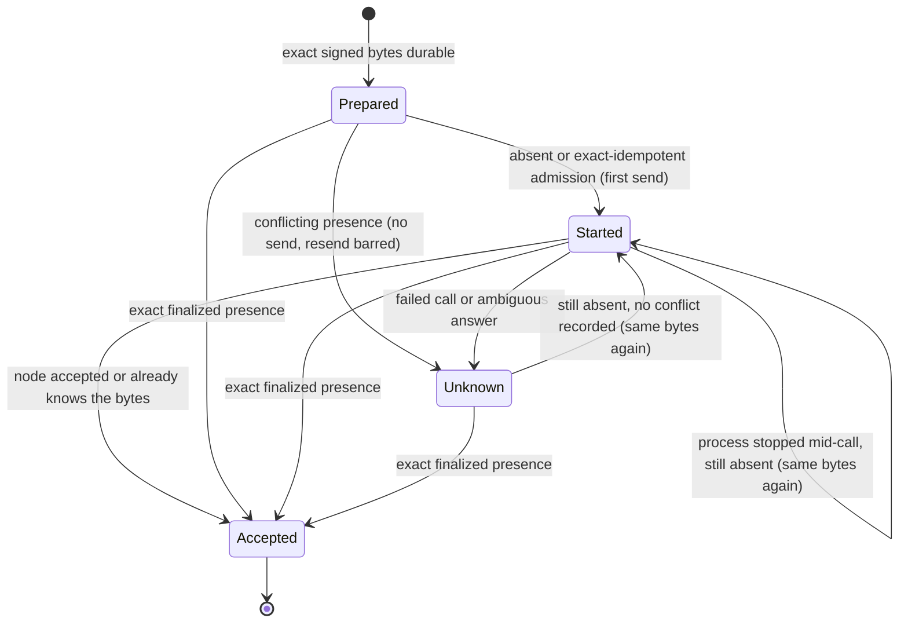

# ADR 0218 — An exact LEZ claim that did not land is sent again

Status: Accepted, 2026-11-27. Relates to issue #174. Amends the no-rearm rule
of [ADR 0033](0033-persist-public-effects-before-submission.md) and
[ADR 0036](0036-prove-bounded-lez-claim-absence-before-first-send.md) for one
effect, the BTC actor's exact LEZ claim; every other effect keeps its single
attempt. Threat-model delta: TM-0010's control and INV-06's wording; see
below.

## Context

A Bitcoin swap's LEZ claim is one transaction that its owner's actor sends
through the swap's LEZ sidecar: the Taker's revealing claim when it sells
Bitcoin, the Maker's follow-up claim when the Taker sells LEZ. The public
effect journal gave it one send. Any outcome other than an acceptance of the
expected transaction id left the row `Unknown`, a process stopped during the
call left it `Started`, and neither state could send again: complete absence
and the exact-idempotent admission both answered observe-only.

That is the right rule when the transaction may be at the node. It is the
wrong one when it never arrived:

- the sidecar could not be reached, or its inclusion lookup failed before
  the send (it answers `unavailable` and sends nothing);
- the send failed on the way to the sequencer, or the sequencer answered
  something that proves neither acceptance nor refusal;
- the actor or the sidecar stopped during the call.

The actor cannot tell these apart: its port reports one failed call. From
then on observation waited for a transaction nobody had, until the swap's
windows decided it. For the Maker's follow-up claim that is a loss of both
legs: the Taker already holds the Bitcoin, and from the LEZ refund time it
takes its LEZ back as well.

## Decision

An exact LEZ claim whose send was already authorized, and which the chain
still shows absent, is sent again.

1. **The journal** (`SqlitePublicEffectJournal::resend_exact_lez_claim`)
   authorizes one more send of a `Lez` + `Claim` row that is `Unknown` or
   `Started`, on the same evidence the first send needs, taken after the
   failed attempt: `Absent` (the complete bounded scan of ADR 0036), or
   `ExactIdempotentLezClaimSubmissionSafe` bound to the durable id and bytes
   (a prefix of the window). `Unknown` moves back to `Started` in the same
   SQLite transaction, so the resend's outcome is recorded as a first send's
   is and a stop during the resend leaves the same resendable `Started`.
   `Prepared` is not resent (its first send belongs to `reconcile`);
   `Accepted` and `Rejected` are not resent; `Uncertain` and unavailable
   observations authorize nothing. Any other chain or operation is refused:
   Bitcoin effects, LEZ funding and LEZ refunds keep their one attempt.
2. **Conflicting presence still ends every send.** ADR 0036 burns a
   `Prepared` row to `Unknown` when the chain shows a claim that contradicts
   the durable one. That row has the shape of a row whose send was
   ambiguous, so the journal now records conflicting presence in a table of
   its own (`public_effect_conflicting_presence`), for `Prepared`, `Started`
   and `Unknown` rows alike, and a marked row is never resent. A later exact
   match still accepts it.
3. **The actor** (`authorize_exact_lez_claim_send`, used by the native and
   the custom-token claim observer) reconciles as before and, when the
   answer is observe-only under absence or the exact-idempotent admission,
   asks the journal for the resend. It sends the journal's bytes under the
   same deterministic request id as the first send.
4. **The revealing claim is resent only inside its claim window**
   (`lez_claim_resend_admitted`). Its signature discloses the adaptor secret
   to whoever sees the transaction, included or not, and a Taker Node keeps
   driving a swap whose claim it submitted across the window's close, to see
   a claim that was included in time. Such a drive never offers the
   revealing claim again once the wall clock is past the agreement's
   earlier-refund bound (`claim_window_closed`, the bound under which the
   Nodes offer the claim's first send): from there the Maker's refund can
   win the escrow while the disclosed secret still spends the Bitcoin. The
   Maker's follow-up claim discloses nothing, its secret being public
   already, and is resent for as long as it is absent.
5. **The sidecar** decides the completed witnessed claim's submission on the
   chain again whenever it is asked for under that request id
   (`witnessed_claim_submission`, in `submission_success_decided_again`): it
   looks the transaction up, answers `already_known` when it is included, and
   otherwise sends it once more. A journaled `unknown_submission_outcome`,
   in-flight marker or acceptance is no longer replayed for it; a refusal
   before the send was already tried again.

No schema of an existing table changes. The new table is additive; a journal
written before this ADR holds no marks, so its `Unknown` LEZ claim rows are
resendable, the ones burned by conflicting presence included.

## Why sending the same bytes again is safe

The claim is fixed before the first send and never rebuilt:

- its message is reserved once by `prepare_witnessed_claim`, with the
  aggregate authority account's nonce read once and stored;
- it is completed with the one aggregate BIP340 signature the swap's adaptor
  protocol yields, and the completed transaction is stored by the sidecar's
  planner and, with its id and SHA-256 digest, by the actor's journal before
  any presence lookup;
- every send, first or later, passes the sidecar's owned-submission check
  against those stored bytes.

A LEZ public transaction names the nonce of each signer account. The pinned
LEZ v0.2.4 state machine admits a transaction only when those nonces equal
the accounts' current ones (`validated_state_diff`, "Check nonces corresponds
to the current nonces on the public state") and advances each signer's nonce
when it applies the transaction (`apply_state_diff`). The claim's only
signer is the swap's aggregate authority account, whose key is the 2-of-2
aggregate of this swap: no other transaction is ever signed for it. So:

| What happened to the earlier send | What the resend does |
|---|---|
| Never reached the sequencer | The sidecar finds nothing and sends it: the first real send. |
| Reached it, not yet in a block | The same transaction id is offered again; at most one copy is included, the other fails the nonce check. |
| Included, not yet final | The sidecar's lookup finds it and answers `already_known`; nothing is sent. |
| Final | The actor's observation is `PresentExact`; it never asks. |
| Reached it and was dropped | Sent again, as if never sent. |
| Another transaction took the nonce | Cannot happen without both parties' signature. If the escrow was refunded first, the claim fails in the escrow program; resending it changes nothing. |

The resend therefore cannot pay twice and cannot pay another party. What it
can do that the failed attempt may not have done is publish the claim's
signature; for the revealing claim that is the adaptor secret, which is why
item 4 bounds its resend by the claim window.

## Trust and limits

- The argument rests on the pinned sidecar and the pinned LEZ node's nonce
  rule, as ADR 0036's absence proof rests on the pinned indexer.
- A resend happens once per drive of the actor, only while the journal holds
  no acceptance and the bounded observation still shows the claim absent.
  Once the node accepts the bytes the row is `Accepted` and the actor only
  observes. A claim the node accepted and the sequencer then dropped is
  therefore still not sent again by the BTC actor; the ZEC path's revealing
  claim covers that case through its own lineage.
- The claim window is read from the wall clock, as the Nodes read it when
  they offer the claim. The actor does not bound a claim's first send: a
  Node drives the claim only while its status offers it. A first drive that
  could not classify the claim (an uncertain observation) sends nothing and
  still succeeds, and the Taker Node then counts the claim as submitted and
  keeps observing past the window; the first send from such a later drive is
  not bounded by this ADR.
- Bitcoin claims and refunds, LEZ refunds and the witnessed escrow keep
  their rule: authority given back only when nothing was offered (#156),
  never after an ambiguous outcome.

## Consequences

- `crates/swap-store/tests/public_effect_journal.rs` covers the resend from
  `Unknown` and `Started` under both kinds of evidence, the refusal for other
  effects and other observations, and the bar after conflicting presence.
- `crates/btc-reference-actor/src/issue174_tests.rs` drives both owned
  claims (the Taker's revealing claim selling Bitcoin, the Maker's follow-up
  claim selling LEZ) through a failed call, a garbled answer, a stop
  mid-call, a contradiction on the chain, the closed claim window, and the
  custom-token claim.
- `compat/lez-v0_2-sidecar/tests/bridge_witnessed_claim_resend.rs` covers the
  sidecar: a refusal before the send, an unknown outcome and an in-flight
  marker left by a kill are each decided on the chain again under the same
  request id.
- The devnet scenario `claim-send-fails` (both directions, `full` tier, a
  devnet built with `LEZ_TEST_HOOKS=1`) refuses the claim's submission twice
  in its owner's sidecar and requires the swap to complete on both Nodes.

## Threat-model delta

TM-0010 (an uncertain or replayed effect executes twice): its control now
names the exact LEZ claim as the one effect offered again after an unknown
outcome, and why that cannot execute twice. INV-06 keeps "no rearm of spent
authority" and names the same exception. No new threat: the resend adds no
transaction, signer or secret that the first send did not already expose.
