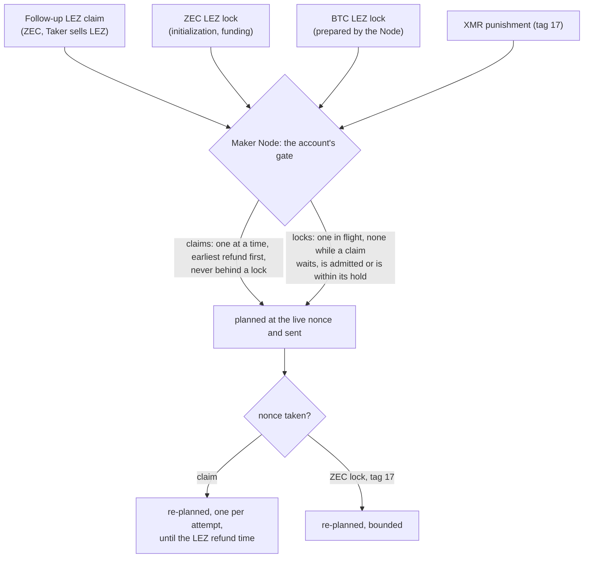

# ADR 0219 — One gate for every LEZ transaction of the Maker's account

Status: Accepted, 2026-11-27. Extends the one-claim gate of
[ADR 0216](0216-zec-taker-reveals-first-in-both-directions.md) (the Maker's
follow-up LEZ claims go one at a time) to the account's other transactions,
and bounds how long a submitted claim holds the next. Issue #176.

## Context

A Maker Node signs with one LEZ account for every pair. Four kinds of its
transactions are planned at that account's live nonce:

| transaction | planned by | re-planned when its nonce is taken |
|---|---|---|
| ZEC follow-up LEZ claim (`TakerSellsLez`) | the swap's actor, `claim` | yes: one re-plan per attempt while the claim can land (issue #172) |
| ZEC LEZ lock (`TakerSellsForeign`: initialization, then funding) | the swap's actor, `drive` | yes, five times, then the swap stops by name |
| BTC LEZ lock (`TakerSellsForeign`: initialization and funding) | the Node's escrow preparer; the actor sends it | no: the swap expires with nothing locked |
| XMR punishment (tag 17) | the swap's actor, `recover` | yes |

A Bitcoin and a Monero LEZ claim and every LEZ refund are signed by the
swap's own authority and take no nonce of the account.

Two transactions planned before the first is in a block carry the same
nonce, and the sequencer keeps one. Only the follow-up claim has a deadline
with funds behind it: the Taker has taken the Maker's Zcash, and the Maker's
LEZ claim must be in a block before the LEZ refund time. Until this ADR only
the claims were coordinated, and only with each other: a lock planned while a
claim was pending could take the claim's nonce, and each such loss cost the
claim a re-plan. A submitted claim also held every other claim until it was
final or its swap's LEZ refund time came, which on a network whose finality
takes longer than the margin leaves the next claim no window.

## Decision

1. **One gate, in the Maker Node's actor supervisor.** Every effect that
   plans or sends one of the four transactions passes it, under one lock of
   the process, before its actor runs. The supervisor tells them apart by the
   actor's status: a Zcash claim with `next_action: claim_lez`; a Zcash drive
   with `maker_lock: lez` (a field the status carries while the Maker's lock
   is its next step; `zcash` when that lock is the Zcash funding); a Monero
   recovery with `next_action: punish_lez`; a Bitcoin drive at
   `taker_lock_confirmed` of a swap whose escrow the Node prepared. The
   Bitcoin escrow preparer asks the same gate before it plans.

2. **Claims go first and never wait for a lock.** A lock is neither planned
   nor sent (`lez_lock_waits_for_claim`) while a follow-up claim of another
   swap waits at the gate, is admitted, or was submitted and is within its
   hold. A held lock is looked at again after the requeue delay.

3. **Locks go one at a time** (`lez_lock_waits_for_lock`): a lock that sent
   a transaction, or the first of its pair, holds the other locks until its
   next attempt finds nothing more to send, for two minutes at most from its
   first admission. Past that it is waiting for LEZ finality, which takes no
   nonce, and the others are planned beside it.

4. **A submitted claim holds the next claim for a bounded time.** Its
   in-flight marker records when its current bytes were first submitted
   (`submitted_at_ms`; a re-planned claim records its own time). It holds
   the account for one admission bound from then: the attempt timeout, half
   the profile's margin at most, and the stop grace. That is time to be
   included, which is what takes the nonce; finality is not waited for. The
   bound a failed swap's claim already had is the same one.

5. **The capacity is the queue bound.** A claim holds the next for
   `landing = min(worst submit-to-final, the hold of 4)`; with
   `slot = 2 × (landing + held-claim retry)` the Maker accepts
   `1 + ⌊(M − 2 × landing) / slot⌋` open `TakerSellsLez` ZEC swaps, and none
   when `2 × landing > M`. A claim alone waits for no slot. 3 under the
   devnet profiles and 1 under `deterministic-local-v3`, as before. Under
   `public-testnet-v3` the bound is 10 (it was 0, raised to 1, when the slot
   was sized by two hours of LEZ finality); the Maker accepts 1 there,
   because no LEZ claim has been measured on that network and the number of
   swaps whose Zcash it exposes to an unmeasured network is a separate limit.

## Why the claim cannot be exhausted or delayed past its window

- *Its recovery is not exhaustible.* A superseded claim is re-planned once
  per attempt, attempts are at least a second apart, and the protocol's
  bound is 16,384 re-plans, more than the seconds in the longest LEZ refund
  delay of any profile (14,400). The claim is re-planned until the LEZ
  refund time whatever takes its nonce: a lock, the operator's own
  transaction, another Node on the same account.
- *The Node's own locks cost it at most two re-plans.* From the moment a
  claim reaches the gate no lock is planned or sent. The only lock
  transactions that can still be included ahead of it are those of the one
  lock in flight that were sent before: two at most (a Bitcoin pair; a
  Zcash lock sends its funding only after its initialization is observed).
  Each costs one re-plan, made in the next attempt after the requeue delay.
- *Other claims cost it a bounded wait.* The claims ahead of it (earlier LEZ
  refund time) each hold it for one landing time and one retry; the capacity
  keeps that queue inside the margin.

A held lock is a delayed attempt, which every actor already tolerates (a
Node that was down behaves the same): the lock's own cutoffs decide whether
it is still sent.

## Consequences

- A lock waits behind the claims of other swaps: at most the queue's length.
  A Maker lock that misses its cutoff for it is not sent, and that swap ends
  by the Taker's refund.
- A claim that arrives while a lock's transaction is on its way can take
  that lock's nonce. A Zcash lock and a tag 17 are re-planned. A Bitcoin
  LEZ lock is not: that swap expires with nothing locked by the Maker, as it
  did before for any nonce loss.
- A claim not included within its hold no longer holds the next claim: both
  may then be planned at one nonce, and the one that loses is re-planned in
  its next attempt. Funds are never at stake in that; the alternative cost
  the next claim its window.
- The locks in flight are kept in the Node's memory. A Node that restarts
  forgets one lock in flight, which can cost the next transaction one
  re-plan. The claims' side stays in marker files beside each swap's state.
- Two Nodes configured with one LEZ account are not coordinated with each
  other, and neither are the operator's own transactions from that account;
  the claim's re-plans cover both.
- No agreement, profile or flow changes: who locks first and who claims
  first are as before.

## Verification

- `maker_actor_supervisor.rs`:
  `the_makers_lez_locks_wait_for_a_pending_lez_claim_and_for_each_other_and_no_claim_waits_for_a_lock`,
  `a_submitted_lez_claim_holds_the_next_claim_for_its_hold_not_until_it_is_final`,
  `a_makers_zcash_funding_drive_passes_the_lez_account_gate`.
- `zec_followup_claim_contention.rs`: the Maker's follow-up claim is
  superseded more than five times across attempts of the real actor under
  the real supervisor, reports `lez_claim_nonce_contention`, and lands.
- The capacity: `the_capacity_is_the_queue_bound_and_never_a_zero_raised_to_one`.
- On the devnet, `zec-maker-claim-collision` (selling LEZ): the sidecar's
  test hook `claim-nonce-thefts` sends six transactions of the Maker's
  account at the claim's nonce, one per submission; the claim is superseded
  and re-planned each time and the swap completes.
