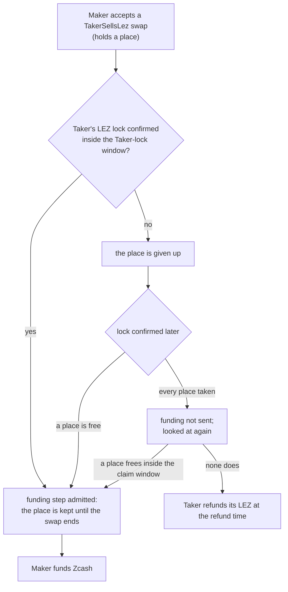

# ADR 0220 — An unfunded ZEC swap gives its place up after the Taker-lock window

Status: Accepted, 2026-11-27. Changes which swaps count against the capacity
of [ADR 0216](0216-zec-taker-reveals-first-in-both-directions.md) and
[ADR 0219](0219-one-gate-for-the-maker-accounts-lez-transactions.md).
Issue #178, item 2.

## Context

A Maker accepts a bounded number of open ZEC `TakerSellsLez` swaps, so that
its follow-up LEZ claims fit the margin one after another. The count took
every accepted swap in that direction until its actor ended or its LEZ
refund time passed. A Taker that accepted and never locked therefore held a
place for the whole LEZ refund delay without putting anything on a chain:
four hours under `public-testnet-v3`, where the capacity is one.

A swap needs a place only if the Maker funds its Zcash: without the Maker's
funding the Taker has nothing to claim, reveals nothing, and the Maker has
no follow-up claim to queue.

## Decision

1. **The Taker-lock window.** An accepted swap holds its place for
   `taker_lock_window = (LEZ refund delay − margin) / 2` from the Maker's
   acceptance: half the span in which the Maker may fund at all. It is
   derived from the profile's signed parameters and is not one of them: 300 s
   under `deterministic-local-devnet-v7`, 180 s under `-v8`, 45 s under
   `deterministic-local-v3`, 3,600 s under `public-testnet-v3`.
2. **A funded swap keeps its place.** Before the Maker's Zcash funding drive
   runs (the actor's status reads `maker_lock: zcash`: the Taker's lock is
   confirmed), the Node admits the funding step in its store
   (`admit_maker_zec_funding`). An admitted swap counts until its schedule
   ends or its LEZ refund time passes.
3. **Past the window the place is given up, not the swap.** The swap stays
   accepted and its actor keeps observing the Taker's lock.
4. **A late lock is served only while a place is free.** The admission of a
   swap past its window succeeds only if fewer swaps than the capacity hold a
   place, and then takes one. Otherwise the funding drive is not run
   (`zec_funding_waits_for_free_place`) and the swap is looked at again at
   the Node's backoff: funded if a place frees while the actor's own cutoffs
   still allow it, else never, and the Taker refunds its LEZ at the refund
   time.

The acceptance of a new swap and the admission of a funding step are each one
`BEGIN IMMEDIATE` transaction on the Node's store and read the same count,
so they are ordered: the swaps holding a place never exceed the capacity.

## Why it is safe

- *The Maker is never over-committed.* Zcash is funded only by the drive the
  supervisor runs after the admission, and an admitted swap holds a place.
  So the swaps whose Zcash is funded and unsettled are at most the capacity,
  which is what the claim queue of ADR 0219 is sized for.
- *A Taker that locks late loses time, not funds.* Its LEZ sits in the
  escrow. The Maker has no preimage for it (the Taker reveals only by
  claiming Zcash the Maker funded), so it cannot claim; the Taker refunds at
  the LEZ refund time. The Maker does not ignore the lock: it funds as soon
  as a place is free, within its cutoffs.
- *A lock pending at the window's end* is treated by when the Maker
  confirms it: confirmed before the window closes it is admitted without a
  capacity check; confirmed after, it needs a free place. There is no
  instant at which the place is both given to a new swap and kept.
- The window runs on the Maker's clock from the acceptance it recorded; the
  Taker cannot move it.

## Consequences

- A Taker that accepts and never locks holds a place for the window (an
  hour instead of four under `public-testnet-v3`; three or five minutes
  under the devnet profiles), then the next taker is served.
- A Taker whose lock is confirmed after the window while the Maker is at
  capacity waits, and may have to refund. Its lock is not refused on the
  chain: nothing tells it before it locks. A Taker that locks at once is not
  affected.
- The window does not bound an attacker who locks: that costs it the lock's
  funds for the refund delay, which is the swap's ordinary cost.
- A swap in this store from before this change has no admission recorded: it
  counts for its window and is admitted, with the capacity check if the
  window has passed, at its next funding attempt.
- No agreement, profile or flow changes.

## Verification

- Store: `an_unfunded_taker_sells_lez_swap_gives_its_place_up_and_a_late_lock_needs_a_free_place`
  (`crates/swap-store/tests/zec_sdk_recovery.rs`).
- Node: `a_taker_lock_confirmed_after_its_window_is_funded_only_once_a_place_is_free`
  (`crates/maker-node/tests/maker_actor_supervisor.rs`).
- The status field: `the_status_names_the_makers_pending_lock_leg_only_while_it_is_next`
  (`crates/zec-reference-actor/src/command.rs`).
