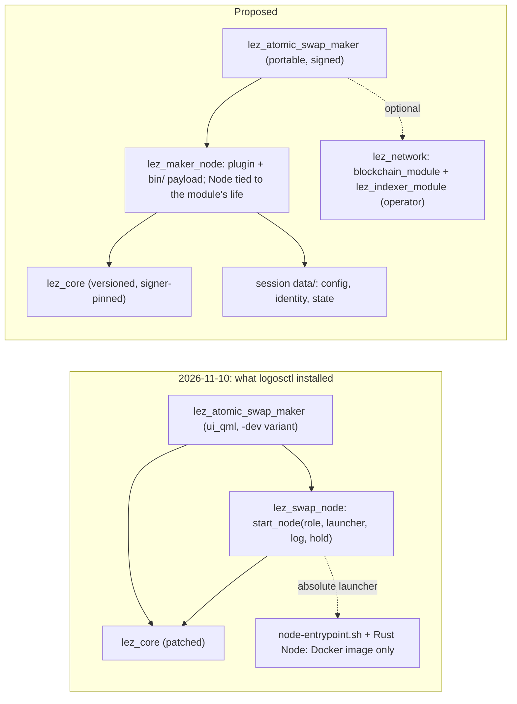

# Logos-native packaging: what the official tools say about PR #120, and how to close the gaps

Status: Proposed — 2026-11-10; (a) and (c) implemented 2026-11-11 (below,
"What was built"); release variants (d1 without signing) and B3 implemented
2026-11-11 ("Release packages and the LEZ network")

The official Logos path is source → logos-module-builder → module → `lm` →
LGX → `logosctl package install` (dependencies, root hash) → a session
(`modules/ data/ keyring/ logs/`) → `module load|reload`, `call`, `watch`,
`stats`, headless or in Basecamp. This note records what that path does with
PR #120's packages today and proposes how to close the gaps. Every "observed"
claim comes from one retained run of `deploy/scripts/logos-native-acceptance.sh`
(transcript: [docs/evidence/logos-native-2026-11-10](../evidence/logos-native-2026-11-10/README.md);
step numbers `S..` refer to it) or from the spike that preceded it. The rest
is marked as a proposal or a guess.

## What we observed

The run used the packages as built at 13:13Z on 2026-11-10, before commit
`22196d30` (smaller upstream patches; the signer socket moved from lez_core
into lez_swap_node). Today's patched versions are lez_core `0.4.1-sign.4` and
lez_indexer_module `1.1.1-rpc.4` (`deploy/builder/patches/README.md`). The
transcript has not been rerun on those packages.

Packages (all unsigned; S08–S20):

| package | version | manifestVersion | variants | declared dependencies |
|---|---|---|---|---|
| lez_atomic_swap_maker (desk) | 0.2.5 | 0.3.0 | linux-amd64-dev | chat_module, delivery_module, lez_core, lez_swap_node |
| lez_swap_node | 0.2.0 | 0.2.0 | linux-amd64 | lez_core |
| lez_core (patched) | 0.4.1-import.3 | 0.3.0 | linux-amd64 | — |
| lez_indexer_module (patched) | 1.1.1-rpc.3 | 0.2.0 | linux-amd64 | — |
| blockchain_module | 0.2.4 | 0.3.0 | linux-amd64, linux-arm64, darwin-arm64 | — |
| chat_module / delivery_module | 0.2.2 / 0.2.0 | 0.3.0 | linux-amd64-dev | delivery_module / — |

(lez_swap_node was rebuilt with the `lez_core` dependency during the spike;
the earlier build, 0.1.0, declared `dependencies: []`.)

1. **logosctl 0.3.2 and 0.3.0 install and run our core modules.** A clean
   session installs lez_core, lez_swap_node, lez_indexer_module and
   blockchain_module 0.2.4 from their files, loads lez_swap_node together with
   its declared lez_core, and answers `call lez_swap_node node_status`
   (S56–S68, S90). The v0.2-era logoscore 0.2.3 does the same from a modules
   directory (S92–S93). So the v0.2-built core LGX is not the blocker.
2. **The desks do not install with logosctl.** They are built with the
   builder's development variant tag `linux-amd64-dev`; logosctl takes only
   `linux-amd64` ("Package does not contain variant for platform", S50, S91).
   The era `lgpm` (the desks' nix installer) is the mirror image: it takes
   only `-dev` and refuses the portable core modules (S94). No single
   installer takes the whole graph today; Basecamp works only because
   `stage-basecamp-package.sh` renames the variant in an installed tree, which
   no longer matches any published root hash. chat_module and delivery_module
   as we build them are `-dev` too (S58–S59).
3. **Installing from a file resolves no dependencies.** The (re-labelled) desk
   installs alone and `package deps --recursive` then lists chat_module,
   delivery_module, lez_core and lez_swap_node as `not_installed` (S53–S54).
   Dependency resolution only happens against a catalog — and the default
   catalog (logos-co/logos-modules-release) carries *other* packages under our
   names: lez_core 0.5.1, lez_indexer_module 1.2.1, blockchain_module 0.3.4,
   chat_module 0.3.0, delivery_module 0.3.3. Our plain-string dependencies
   ("any version, any signer") would resolve to them.
4. **`--root-hash` is not checked for a file install.** An all-zero root hash
   is accepted (S62). Integrity of a local file rests on the signature (none)
   or on the caller comparing `package show`'s `rootHash`, which the script does.
5. **logosctl does not load a `ui_qml` package** (`module load
   lez_atomic_swap_maker`: "not found", S65); it installs it into `plugins/`.
   The desk's backend runs only in Basecamp.
6. **The package graph has no Node.** Nothing installed contains
   `node-entrypoint.sh` or `lez-maker-node` (S69). `start_node` with the
   launcher Compose provides returns 1 (S70) and nothing runs (S71).
7. **The supervisor works, and duplicates the runtime.** With a stand-in
   launcher, lez_swap_node starts the child, restarts it after an exit
   (`starts: 2, last_exit: "exit 7"`) and holds it while the hold file
   exists (spike; S73–S74). But:
   - `module stats` shows the module host, not the Node (S76);
   - `module reload lez_swap_node` kills the Node and nothing starts it again:
     the supervision state is gone (S78);
   - when the module host crashes (`kill -9`), the daemon logs "Module process
     crashed" but `module ls` says `not_loaded`, not `crashed` (S81); the Node
     keeps running as an orphan (S82), and loading the module and starting the
     role again — what the desk does — gives **two Nodes** (S84). In Compose
     the container's death hides this; on a user's machine it would not.
     node-entrypoint.sh removes `node.sock` before starting, so a second real
     Node would take over the socket while the first still owns the store.
8. **Session.** Each module host is `logos_host --name <m> --path
   <session>/modules/<m>/<plugin> --instance-persistence-path
   <session>/data/<m>/<instance id>`; the instance directory stayed the same
   across reload and crash. `keyring/` holds trusted *package-signing* keys
   only. `package remove lez_core` takes lez_swap_node and the desk with it,
   and leaves their `data/` directories behind (S86–S88).
9. **Payload files survive packaging.** A probe package with an ELF and a
   shell script under `variants/linux-amd64/bin/` (0755) was built with lgx
   0.1.0, installed by logosctl 0.3.2 with its modes kept, and the ELF ran
   from `modules/<m>/bin/` (spike). The current LGX spec, though, says files
   are written `0644`; a newer lgx may drop the execute bit.
10. **Tools.** logosctl 0.3.x ships for linux x86_64/aarch64, macOS aarch64
    and Windows; logoscore 0.2.3 for linux x86_64/aarch64. `lm` has no
    released binary: the builder's lm 0.1.0 has `metadata|methods|events` but
    no `verify`, so `lm verify --did` was not run (S49), and there is no DID to
    pin anyway. Our core packages carry only the build host's variant; only
    blockchain_module 0.2.4 is multi-platform. Every
    observation in this note was made on a linux-amd64 host. Two things have
    run on arm64 since, both on an Apple-silicon Mac where Docker Desktop runs
    the `linux-arm64` variant of the packages: the acceptance walk of this
    note, with every step's verdict as on amd64
    (`docs/evidence/logos-native-2026-11-11-arm64/`), and the Compose stack,
    built from nothing and smoke-tested
    (`docs/evidence/macos-arm64-smoke-2026-11-11/`). Neither is a native
    darwin package: none exists.

## Proposal

### (a) The role's Node enters the package graph

Options:

- **A1 — a payload module per role (recommended now).** `lez_maker_node` and
  `lez_taker_node`, `type: core`, each variant carrying the role's
  executables (`bin/lez-<role>-node`, its chat gateway, actors, CLI,
  healthcheck, the v0.2 sidecar it spawns) and a small plugin that is
  lez_swap_node's supervisor, specialised to one role. The plugin finds its
  payload through `LogosModuleContext::modulePath()` and its state through
  `instancePersistencePath()` (both in the cpp-sdk our builder pins), so
  `start` takes no paths. Depends on `lez_core` (signer). The Maker package
  carries no Taker binary and vice versa: deploy/role-symmetry.json gains the
  module names and a check that lists each LGX (`lgx manifest`, `tar -t`) and
  fails on the other role's executable names. lez_swap_node either becomes
  this plugin's shared source (built twice) or disappears.
- **A2 — both payloads inside lez_swap_node.** Rejected: it breaks the role
  symmetry contract (a role's artifact must not carry the other role's
  binaries).
- **A3 — the Node as a library**, a Rust cdylib the module loads in process,
  as blockchain_module wraps logos-blockchain-c and lez_core wraps
  wallet_ffi. The most native (the runtime then owns the Node's life
  outright), but it changes the Node's process model (it spawns sidecars and
  actors per swap) and touches the frozen M3 engine. A later target, not the
  next step.
- **A4 — the Node as a daemon managed by logosctl** (#115's "Maker stays a
  daemon under logosctl"): logosctl manages modules only; there is no
  non-module daemon to manage. Not available.

Size: the stripped Maker payload is about 146 MB, the Taker's about 230 MB
(it carries the zec-local-poc tools); the LGX decompression cap is 1 GiB per
package, so three platform variants of the Taker (≈ 690 MB) fit, barely. The
ZEC proof-of-concept tools should move out of the role payload.

Mapping onto the session (proposal):

| today (Compose) | in the session |
|---|---|
| `/var/lib/lez/<role>` (state volume) | `data/lez_<role>_node/<id>/state` (0700) |
| `/run/lez/<role>` sockets | a short directory under `$XDG_RUNTIME_DIR` (or `$TMPDIR`) named by the instance id — Unix socket paths are limited to 108 bytes and session paths are long |
| `LEZ_*` environment, `/run-config`, market-bootstrap.env | one config document, set by `configure(json)` and kept in `data/…/config.json`; the desk shows and edits it |
| `/run-lez-identity/identity.json` | created or imported once into `data/…/identity.json` (0600); backup = the session's `data/` |
| LEZ signing key | stays in lez_core's wallet (already: lez_swap_node's `serve_signer` asks lez_core for each signature); not in `keyring/`, which is for package signers |
| socat loopback forwards to bitcoind/sequencer/indexer/zebra | not needed when the endpoints are configured as real addresses; the BTC adapter and sidecars accept only loopback endpoints today — relaxing that is BTC-adjacent and needs its own review |
| Node log via `log_file` | the Node's stdout/stderr to the host's, so logosctl's rotated `logs/daemon.log` carries it (GUESS: the pipe is inherited; not verified) |

### (b) The role package and the LEZ network

- **B1 — hard dependencies on blockchain_module + lez_indexer_module.** Every
  user installs and runs a full LEZ node and indexer (≈ 160 MB of packages,
  chain storage, ports), and the network modules still need a deployment
  file that today only Compose writes. Wrong for a trader's machine.
- **B2 — `optional_dependencies` (manifest 0.6.0+).** The installer offers
  the network modules; the role runs without them against configured
  endpoints. Needs a builder that writes manifest ≥ 0.6.
- **B3 — an explicit remote network (recommended).** The role package
  declares no network module; its config names the sequencer and indexer
  endpoints (the public testnet's, or a self-hosted operator's). lez_network
  stays a separate *operator* package that declares blockchain_module and
  lez_indexer_module (it already does) and is what the devnet harness
  installs. Once the builder writes manifest ≥ 0.6, the desk lists
  `lez_network` under `optional_dependencies`, so the relation is visible in
  `package deps` without forcing it.

Whatever the choice, dependencies must stop being bare names: object entries
with a version range and, once we sign, the signer DID
(`{"name": "lez_core", "version": "0.4.1-import.3", "signer": "did:jwk:…"}`),
so a catalog cannot substitute upstream's lez_core 0.5.1 for our patched
build (observation 3). The patched modules could also take distinct names
(`lez_core_swap`), which avoids the collision without manifest 0.7.

### (c) One lifecycle owner

lez_swap_node re-implements restart and hold, and the runtime cannot see
the result (observation 7). Proposal: the runtime owns the module, the module
owns exactly one Node, tied to its own lifetime.

- Loading `lez_<role>_node` with a valid config starts the Node; unloading or
  reloading stops it (SIGTERM to the process group, SIGKILL after 10 s, as
  now). No `start_node(role, launcher, log, hold)` from the desk.
- The Node dies with its host: `PR_SET_PDEATHSIG` on Linux; on macOS a pipe
  the child watches. The Node takes an exclusive lock on its state directory,
  so a second instance refuses to start instead of taking the socket.
- Restart after a Node exit can stay in the module (bounded back-off), but
  every exit is an event (`logos_events: node_exited(code, starts)`) and
  `status()` reports the Node's readiness, pid, restarts and last exit, so
  `logosctl watch` and Basecamp see it. A module that cannot keep its Node up
  should fail visibly rather than loop silently. The hold file becomes a
  persisted `hold(bool)` call.
- Reload keeps state (it is in `data/`) and restarts the Node; the
  acceptance script's S78/S82/S84 become PASS.
- Upstream ask: logosctl should report a crashed module as `crashed` (S81).

### (d) The v0.2 ↔ v0.3 tooling gap

What already works across the gap: logosctl 0.3.x installs and loads our
v0.2-built core packages (manifestVersion 0.2.0/0.3.0) and dispatches calls.
What does not: the desks' dev variants, the unsigned packages, bare-name
dependencies, no headless desk. Migration path, none of which moves the LEZ
protocol off v0.2.4:

1. Build and publish portable packages for everything, desks included (the
   builder's `lgx-portable`, as the core modules already use), merge platform
   variants with `lgx merge`, sign with `lgx sign`, publish the DID; run
   logos-native-acceptance.sh in CI on the release artifacts.
2. Move the module builder pin to a revision that writes manifest ≥ 0.6
   (versioned/signed dependencies, optional dependencies, `assets/lidl`,
   the 256×256 icon for `ui_qml`). The spec says tooling reads 0.2.x–0.7.x;
   whether Basecamp 0.2.0 reads a 0.7 manifest is not verified.
3. Replace logoscore 0.2.3 in the images with logosctl 0.3.x and move the
   Basecamp pin to its v0.3 release, so the harness runs the same runtime a
   user installs.
4. Moving LEZ itself to v0.3 (lez_core 0.5, indexer 1.2, blockchain_module
   0.3) is a protocol change and its own milestone; the upstream patches would
   have to be rebased onto it.

## What was built (2026-11-11)

Option A1 with lez_swap_node kept as the one lifecycle owner, and the parts of
(c) that need no runtime change. Evidence:
[docs/evidence/logos-native-2026-11-11](../evidence/logos-native-2026-11-11/README.md)
(both roles) and the landing checks recorded there.

- **Payload packages.** `lez_maker_node` and `lez_taker_node`
  (`modules/lez-<role>-node`, `type: core`, version 0.1.0): a small plugin
  (`launcher()` → `<modulePath>/bin/node-entrypoint.sh`, `payload()` →
  `bin/payload.json`) and, under `bin/`, the launcher
  (`modules/lez-role-node/node-entrypoint.sh`), the role's Node and CLI (the
  Taker's registry initialiser), its Bitcoin and Zcash actors, the LEZ v0.2
  sidecar and the health probe, stripped. `bin/payload.json` names each file's
  sha256 and the build and sidecar sources. Nix builds the plugin
  (`from-scratch.sh --only build:role-node-modules`, same pins as
  lez_swap_node); `deploy/scripts/package-role-node.sh` adds `bin/` with the
  module builder's lgx 0.1.0 (`lgx add`, `lgx verify`) and refuses a package
  whose executables lost their execute bit (lgx 0.1.0 keeps file modes;
  observation 9). One variant per build host; Linux only (swap-store). The
  Maker package names no Taker executable and vice versa
  (`scripts/check-runtime-profiles.py`). The ZEC proof-of-concept provisioners
  are not in the package; they stay in the Taker image for
  `scripts/zec-provision.sh`.
- **Graph.** desk → `chat_module`, `delivery_module`, `lez_core`,
  `lez_swap_node`, `lez_<role>_node`; `lez_<role>_node` → `lez_swap_node`;
  `lez_swap_node` → `lez_core`. Still bare names (observation 3).
- **Start.** The desk, with `LEZ_<ROLE>_NODE_LAUNCHER=package`, asks
  `lez_<role>_node` for its launcher and calls
  `lez_swap_node.start_node(role, launcher, log, hold)`. The payload plugin
  starts nothing itself: one owner. Headless, `logosctl call lez_<role>_node
  launcher` then `call lez_swap_node start_node` does the same.
- **Lifecycle (c).** The Node gets `PR_SET_PDEATHSIG` (SIGTERM): liblogos stops
  a module host with SIGTERM and the host has no handler, so the module's
  destructor never runs; the kernel now ends the Node with its host. The
  launcher's own helpers (loopback forwards, ZEC sidecars) get the same through
  `setpriv --pdeathsig`. The Node's process group is recorded in the module's
  instance directory; before each start a recorded group that still holds one
  of this role's processes (an environment marker every descendant inherits,
  or an executable from the package) is ended (TERM, 10 s, KILL), and after the
  Node exits the rest of its group is ended before the restart. A per-role
  `flock` held by the supervising host makes a second host of the same
  instance wait instead of starting a second Node. `start_node` and
  `serve_signer` requests are recorded and resumed in `onContextReady()`, so
  `module reload lez_swap_node` restarts signer and Node; `stop_node` forgets
  the role. S78/S82/S84 of the 2026-11-10 run are PASS in the 2026-11-11 run.
- **Images.** `deploy/images/<role>-node` are Basecamp with the role package
  unpacked into `<user dir>/modules/lez_<role>_node` (Basecamp scans it beside
  its bundled modules); `/usr/local/bin/<tool>` are links into the package for
  the harness. No Node binary is copied into an image on its own.

Not built: configuration in `data/` (`configure(json)`) — the launcher still
reads Compose environment and mounts; events (`node_exited`) and readiness in
`status()`; manifest ≥ 0.6; signed packages and signer-pinned dependencies.
Basecamp 0.2.0 does not reload a crashed module host, so after a host crash
the Node stays down (no orphan) until the module is loaded again.

## Release packages and the LEZ network (2026-11-11, b)

Evidence: [docs/evidence/logos-native-2026-11-11-b](../evidence/logos-native-2026-11-11-b/README.md)
(both roles, on the packages of the combined landing).

- **Release variants (d1, without signing).** The `-dev` variant came from the
  builder's `lgx` and `install` outputs, which bundle with nix-bundle-lgx's
  `dev` bundler (variant `<platform>-dev`, libraries resolved from
  `/nix/store`). The builder also has `lgx-portable` (nix-bundle-lgx's
  `portable` bundler: nix-bundle-dir lays the non-Qt libraries beside the
  plugin, variant `linux-amd64`/`linux-arm64`), which our core modules already
  used and which the per-role catalog flakes name. The desks are now built
  from `apps/basecamp#lez-{maker,taker,network}-ui-lgx-portable`, Chat and
  Delivery from their own flakes' `lgx-portable` at the revisions
  `apps/basecamp/flake.lock` pins. `from-scratch.sh --only stage` installs the
  images from those same files (`stage-basecamp-package.sh` lays out what lgpm
  and logosctl lay out; nothing is renamed, a `-dev` package is refused), so
  the image and a logosctl install use one artifact. The module builder's
  lgpm is the development build of logos-package-manager (`cli`), which takes
  only `-dev`; it refuses Logos's own release `blockchain_module` 0.2.4 the
  same way (its `cli-portable` build is the one for release packages).
- **Dependencies with version ranges.** The LGX manifest (0.3.0, the version
  our packages already carry) allows `{"name", "version", "signer"}` entries;
  logosctl 0.3.2 resolves them (`package deps --recursive` shows
  `requiredVersion` and `status: version_mismatch`). Basecamp 0.2.0 and the
  v0.2 runtime read only string entries (logos-package-manager `4871ed19`
  `package_manager_lib.cpp`, logos-module `a3e288a7` `module_metadata.cpp`,
  Basecamp `PluginLoader.cpp`), so object-only entries would stop Basecamp
  loading a desk's modules. `deploy/scripts/pin-package-dependencies.sh`
  therefore writes each of our packages' dependencies twice: first
  `{"name": n, "version": "~<version of n in the release set>"}`, then the bare
  name. logosctl takes the first entry of a name; Basecamp 0.2.0 the string.
  The manifest's root hash covers the variants' files, not the manifest, so it
  is unchanged. `metadata.json` keeps bare names: the builder generates one
  client per entry there (`buildCppPlugin.nix`, `staticDeps`). So the default
  catalog's `lez_core` 0.5.1, `lez_indexer_module` 1.2.1 and `chat_module`
  0.3.0 no longer satisfy our packages (observation 3); distinct names were not
  needed. A catalog build of the per-role flakes (`apps/basecamp/<role>/flake.nix`,
  `lgx-portable`) is not pinned: it gets the bare names of `metadata.json`.
- **B3.** The role packages declare no LEZ network module: the Node reaches the
  sequencer and indexer its configuration names (the public testnet's or an
  operator's). `lez_network` (the LEZ Network desk) is the operator package: it
  declares `blockchain_module ~0.2.4` and `lez_indexer_module ~1.1.1-rpc.4`,
  installs with logosctl, and is what the devnet's `network` Basecamp runs. A
  trader on the public testnet does not install it. Its desk still starts the
  modules only with the configuration paths Compose provides.
- The release set and its `packages.tsv` (name, version, variant, dependency
  ranges, sha256, root hash) are written to
  `deploy/images/basecamp-ui/assets/packages/` by the stage phase and uploaded
  by the release workflow as the `logos-packages` artifact.
- **Signing** is out of scope (owner, 2026-11-11); the packages stay unsigned.
  Nothing upstream blocks it: lgx 0.1.0 has `keygen` (Ed25519, `did:jwk`),
  `sign` (`manifest.sig`), `verify --keyring-dir`, and logosctl a `key`
  command for trusted package-signing keys; no registry is involved.

## The Node's resource use (2026-11-11, c)

`logosctl module stats` lists each module's `logos_host`, never the Node that
`lez_swap_node` started (2026-11-11-b, S95). How the runtime computes it, from
the sources the module builder pins (logos-liblogos, logos-container-subprocess,
process-stats, read from the build's nix store) and the strings of the
`liblogos_core.so` that logosctl 0.3.2, logosctl 0.3.0 and logoscore 0.2.3 ship:

- `logos_core_get_module_stats()` (liblogos `src/logos_core/logos_core.cpp`) is
  `ProcessStats::getModuleStats(ModuleManager::getModuleProcessIds())`.
  `getModuleProcessIds()` is `ModuleLoaderRegistry::getAllPids()`, the union
  of each loader's `getAllPids()`: a `std::unordered_map<std::string, int64_t>`,
  one pid per module name. For process modules that is
  `SubprocessContainer::getAllProcessIds()` (logos-container-subprocess
  `src/subprocess_container.cpp`): the boost::process id of the `logos_host`
  the container launched, keyed by module name.
- `ProcessStats::getProcessStats(pid)` (process-stats `src/process_stats.cpp`)
  reads `/proc/<pid>/stat` fields 14–15 (utime, stime: the process's own
  threads; cutime/cstime are not read) and `VmRSS` from `/proc/<pid>/status`,
  of that pid only. No process group, session, cgroup, `task/*/children` or
  descendant walk: of `/proc`, the shipped `liblogos_core.so` files name only
  `/proc/`, `/stat`, `/status` and `VmRSS:`.
- A module cannot contribute: `ModuleLoader` / `ModuleContainer` have no hook
  for extra pids, the module SDK (`LogosModuleContext`, the universal codegen)
  has no stats interface, and `metadata.json` no field naming processes.

So, of the ways to make `module stats` itself show the Node:

- (a) a runtime way for a module to report or include its child processes:
  there is none (above);
- (b) a configuration the runtime samples that we could meet: the sample is one
  pid's own counters, so only a Node running as threads of the `logos_host`
  process would be counted. That is A3 (the Node as a library loaded in
  process), which changes the frozen Rust engine's process model. Keeping the
  Node in the host's process group or session would not help (neither is
  read) and would give up the Node being its own process-group leader, which
  is how its group is reaped today;
- (c) done: `lez_swap_node` 0.3.1 reports the Node's use itself.
  `node_stats(role)` (`modules/lez-swap-node/src/lez_swap_node_impl.h`, the
  `.lidl` contracts) returns the supervision (state, pid, `uptime_seconds`,
  `starts`, `restarts`, `last_exit`), one entry per member of the Node's
  process group (the Node first, then its forwards and sidecars: pid, ppid,
  name, state, `cpu_percent`, `cpu_time_seconds`, `memory_mb` as VmRSS,
  threads, open fds), their sums under `group`, and the same for the module's
  own host under `host`. The counters are the ones `module stats` uses
  (utime+stime, VmRSS), read from `/proc` with no new dependency;
  `cpu_percent` is measured since the role's previous `node_stats` call, or
  over the process's life on the first call. The `group` sum counts shared
  pages once per process.

The acceptance script records `module stats` as INFO with the upstream request
("`module stats` reports only the `logos_host` process; include (or list) the
processes a module host started") and judges instead that
`logosctl call lez_swap_node node_stats <role>` names the pid `node_status`
gave, exactly the Node's process group as `/proc` shows it (the stand-in Node
and its helper), the `lez_swap_node` host as the Node's parent, and each
process's VmRSS. The desks do not show it. Evidence:
[docs/evidence/logos-native-2026-11-11-c](../evidence/logos-native-2026-11-11-c/README.md)
(13 FAIL per role instead of 14; `node_stats` through each role's Basecamp on
the stack matches `/proc` idle and during swaps).

That run also found a supervisor fault: after a host crash an orphaned
helper of the Node's group is reaped by whatever init the host runs under, and
under one that never reaps (a container whose pid 1 is not an init) the next
host waited the whole 10 s grace for the zombie before starting the Node.
`end_group` now waits only for members that still run.

## The Node on macOS

How a role's Node starts from its Logos package, step by step, and what in
each step assumes Linux or a container.

1. **The desk asks.** With `LEZ_<ROLE>_SIGNER_SOCKET` in the host's
   environment (`apps/basecamp/common/lez_role_signer.h`) the desk opens or
   creates the LEZ wallet in `lez_core` under `LEZ_WALLET_DIR`, imports the
   role's key from `LEZ_<ROLE>_SIGNER_IDENTITY/lez-signer.key`, and has
   `lez_swap_node.serve_signer(socket, account)` answer the Node's signing
   requests on that socket. With `LEZ_<ROLE>_NODE_LAUNCHER=package`
   (`lez_role_node.h`) it then calls `lez_<role>_node.launcher()`, which
   returns `<modulePath>/bin/node-entrypoint.sh` when that file is
   executable (`modules/lez-<role>-node/src/*_impl.cpp`), and
   `lez_swap_node.start_node(role, launcher, LEZ_<ROLE>_NODE_LOG,
   LEZ_<ROLE>_NODE_HOLD)`. Headless, the same calls go through
   `logosctl call`. Nothing in this step is platform-specific.
2. **The supervisor starts the launcher.** `lez_swap_node` forks; the child
   becomes its own process-group leader, gets the host's whole environment
   plus `LEZ_SWAP_NODE=<instance dir>:<role>`, stdin `/dev/null`, stdout and
   stderr appended to the log file, and `execve`s `<launcher> <role>`. The
   launcher's shebang is `#!/usr/bin/env bash`: the first `bash` on the
   host's `PATH`. On Linux the child asks for `PR_SET_PDEATHSIG`; on macOS a
   watcher process waits on kqueue for the host's exit and then ends the
   Node's group. The group is recorded in the module's instance directory,
   and a per-role `flock` keeps a second host from starting a second Node.
3. **The launcher renders the configuration.** `node-entrypoint.sh` reads,
   at fixed container paths: the identity (`/run-lez-identity/identity.json`;
   `lez-signer.key` only when no signer socket is given; the Maker's
   `zcash.key`, which is also its Delivery signing key), the market bootstrap
   manifest (`/run-market/market-bootstrap.env`: escrow program and LEZ
   genesis), the Bitcoin Core RPC cookie (`/run-config/btc-rpc-cookie`), and
   the prepared ZEC corridor under `/var/lib/lez/zec`. It writes owner-private
   copies and the Node's configuration (`btc/runtime.json`,
   `btc/btc-role.json`, the Taker's `role.json`) under the state directory
   `/var/lib/lez/<role>`, and the Maker's public Delivery identity into
   `/delivery`. From the environment: `LEZ_SIDECAR_PORT_BASE` and
   `LEZ_V02_CHANNEL_ID` (required), the sequencer and indexer URLs and route,
   the Bitcoin wallet and claim destination, the recovery timing profile,
   `LEZ_WALLET_SIGNER_SOCKET` and `LEZ_NODE_LOG_FILE`.
4. **The launcher starts helpers.** Four `socat` forwards from
   `127.0.0.1:{18443,3040,8779,18232}` to the Compose hosts `bitcoin-core`,
   `sequencer`, `indexer` and `zebra` (the Bitcoin adapter and the sidecars
   accept only loopback endpoints), and one LEZ sidecar
   (`lez-v02-bridge-poc`) per prepared ZEC corridor, each under
   `setpriv --pdeathsig TERM` where `setpriv` exists. It waits for Bitcoin
   Core's `getblockcount`, asks it for the genesis hash and, with
   `LEZ_BTC_CLAIM_DESTINATION=wallet`, for a claim address.
5. **The launcher becomes the Node.** `exec lez-<role>-node`: the Node keeps
   the launcher's pid, so it leads the group. It creates the owner socket
   `/run/lez/<role>/node.sock` (`maker_health`, `taker_health`, the swap
   API), the ready file `/run/lez/<role>/ready` and, for the Maker, the Chat
   socket `/run/lez/maker/chat.sock`. The Maker writes its Delivery offers
   into `/delivery`; the Taker reads them there and reaches the Maker over
   that Chat socket, which is why Compose mounts the Maker's `delivery_dir`
   and `maker_socket` volumes into the Taker. The Node starts the BTC actors
   (`lez-btc-<role>-actor`, ZEC actors for ZEC swaps) and one LEZ sidecar per
   swap itself, on loopback ports from `LEZ_SIDECAR_PORT_BASE` (400 ports).
   The Node's resource use is read by the module (`node_stats`), from `/proc`
   on Linux and libproc on macOS.

The paths above are the launcher's Linux defaults. Each has its own
variable, and on macOS (`uname -s` is `Darwin`) the defaults sit under one
directory, `LEZ_NODE_HOME` (`~/Library/Application Support/LEZ`), with both
roles side by side so the Taker finds the Maker's files as it does in
Compose:

| what | variable | Linux default | macOS default (under `LEZ_NODE_HOME`) |
|---|---|---|---|
| state (0700) | `LEZ_NODE_STATE_DIR` | `/var/lib/lez/<role>` | `<role>` |
| sockets, ready file | `LEZ_NODE_RUN_ROOT` | `/run/lez` | `run` |
| prepared ZEC corridor | `LEZ_ZEC_STATE_DIR` | `/var/lib/lez/zec` | `zec/<role>` |
| identity | `LEZ_NODE_IDENTITY_DIR` | `/run-lez-identity` | `identity/<role>` |
| market manifest | `LEZ_MARKET_MANIFEST` | `/run-market/market-bootstrap.env` | `market-bootstrap.env` |
| Bitcoin RPC cookie | `LEZ_BTC_RPC_COOKIE_FILE` | `/run-config/btc-rpc-cookie` | `btc-rpc-cookie` |
| Delivery directory | `LEZ_DELIVERY_DIR` | `/delivery` | `delivery` |
| chain hosts, sequencer and indexer URLs | `LEZ_*_HOST`, `LEZ_SEQUENCER_URL`, `LEZ_INDEXER_URL` | the Compose service names | `127.0.0.1` |

A chain host that is `127.0.0.1` or `localhost` gets no `socat` forward: the
service is already on this host's loopback (on a Mac the chains' containers
publish their ports there). The launcher runs under any bash from 3.2 on
(macOS's `/bin/bash`), sums with `shasum -a 256` where `sha256sum` is
missing, sizes the log with `wc -c`, creates its state and socket
directories when they are missing, and refuses a socket directory too long
for a Unix socket path (104 bytes on macOS). Its helpers are `exec`ed from
the launcher's own background jobs, so each is a child of the Node, as
before. In the role's container image the launcher does exactly what it did
before these variables existed: run before and after in
`lez-maker-node:local` with the Node, its CLI and `curl` faked, both roles
printed the same Node arguments, helpers, files, modes and rendered
configuration. `deploy/tests/test_role_node_launcher.py` runs it as Linux
(forwards under `setpriv --pdeathsig`, each the Node's child; none for a
loopback host; none under `setpriv` where `setpriv` is missing) and as macOS
(both roles under one home, under `/bin/bash` 3.2 where present).

Weaker on macOS than on Linux, for the launcher:

- **Helpers and the Node.** Linux: each helper (forward, ZEC sidecar) gets
  `SIGTERM` from the kernel when the Node exits (`--pdeathsig`). macOS: there
  is no such signal; a helper ends when `lez_swap_node` ends the Node's
  process group after the Node exits, or when the kqueue watcher ends the
  group after the host exits. A helper that leaves the group itself is not
  ended. On macOS there are no forwards, so this concerns only the ZEC
  sidecars.
- **No privilege boundary from the container.** On Linux the Node runs as
  its own user in a read-only, capability-less container that sees only its
  role's mounts. On macOS it runs as the desktop user, beside both roles'
  files: the other role's state is protected from it by nothing but the
  same user's file modes (0700, 0600), which do not separate processes of
  one user.
- **The Maker's Chat socket.** Compose shares it with the Taker through a
  volume only those two containers mount; on macOS it is a file under
  `LEZ_NODE_HOME/run/maker` that every process of the user can connect to.

What still assumes Linux or a container: the package build
(`deploy/scripts/package-role-node.sh`) strips with GNU `strip` in a Debian
container and writes one Linux variant.

## Recommended order

1. Done without signing: release (portable) packages for the desks, Chat and
   Delivery, versioned dependencies, B3 (2026-11-11, b). Open: signing.
2. Done: `lez_maker_node` / `lez_taker_node` payload modules with the single
   lifecycle owner (a + c). Open: config in `data/`, identity onboarding.
3. Done: B3 with versioned dependencies. Open: signer-pinned ones (with signing).
4. Builder and runtime pins (d2–d3).
