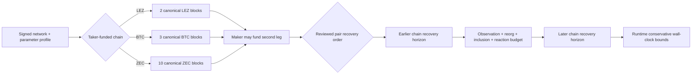

# Confirmation and recovery parameter profiles

Status: review candidate; public-testnet v1 defaults, not audited mainnet
parameters — 2026-07-11

## Scope and safety statement

These named profiles make Milestone 1 assumptions executable and reviewable.
`public-testnet-v1` targets LEZ testnet 0.2, Bitcoin testnet, Monero stagenet,
and Zcash testnet. It is deliberately conservative for integration and demos,
but is not a mainnet security recommendation. Mainnet profiles require measured
chain data, value-at-risk policy, fee-stress tests, and the Milestone 7 review.

No finite block count is a literal worst-case bound on a proof-of-work chain.
Atomicity therefore assumes eventual canonical progress and a configured upper
bound on observation/inclusion delay. If measured latency or reorg depth exceeds
the profile, new swaps stop; existing swaps retain their signed deadlines and
enter operator-alerted recovery. Software never silently shortens a negotiated
window.

## Canonicality policy

| Chain | `public-testnet-v1` claim-ready depth | Reason and response |
|---|---:|---|
| LEZ testnet 0.2 | 2 blocks | Detect a one-block regression before the maker funds; actual block cadence is measured at startup rather than assumed from the sequencer's 10-second fixture default |
| Bitcoin testnet | 3 blocks | More conservative than the pinned COMIT testnet's one-confirmation default while keeping public-testnet E2E practical |
| Monero stagenet | 10 blocks | Matches pinned COMIT `dc6ba84…` stagenet finality configuration; applies to the maker-funded Monero output before the LEZ claim |
| Zcash testnet | 10 blocks | About 12.5 target minutes at 75 seconds/block; zero-confirmation use is forbidden and reorg regression suspends dependent claims |

The relevant row is selected by the chain holding that leg, not by pair name.
For example, a BTC–LEZ swap whose taker funds LEZ waits two LEZ blocks before
the maker creates BTC, then waits three BTC blocks before the taker claims BTC
and the maker follows on LEZ.
XMR-first is unsupported, so Monero is never the taker's first lock.

Every observation binds chain/network ID, block hash/height, transaction ID,
output/account ID, exact value/asset, script/program commitment, and depth. A
depth regression below policy revokes permission before maker funding and
suspends claims after maker funding; the exact committed transaction remains
pinned.

## Recovery horizons

Durations below are relative to canonical inclusion of the funded output. LEZ
uses its consensus clock timestamp. Bitcoin uses block-based BIP-68/CSV. Zcash
uses a BIP-199 CLTV height derived from the funding height. The runtime also
stores conservative Unix-time projections; raw cross-chain heights are never
compared.

| Pair/direction | Earlier recovery | Later recovery | Minimum target gap |
|---|---|---|---:|
| BTC, taker sells BTC | LEZ refund at +6 hours | BTC CSV at +72 blocks (~12 target hours) | 6 hours |
| BTC, taker sells LEZ | BTC CSV at +36 blocks (~6 target hours) | LEZ refund at +12 hours | 6 hours |
| ZEC, taker sells ZEC | LEZ refund at +2 hours | ZEC CLTV at +192 blocks (~4 target hours) | 2 hours |
| ZEC, taker sells LEZ (`public-testnet-v3`) | Maker's ZEC CLTV at +95 blocks (at most 2 hours at 75 s/block) | Taker's LEZ refund at +4 hours | 2 hours |
| XMR, taker sells LEZ | Taker LEZ refund at +12 hours | No Monero timelock: maker recovery follows the canonical refund event/share | Event-gated; 2 LEZ confirmations after refund before Monero recovery |

The XMR row intentionally does not instantiate a fictional Monero deadline.
Its state model is `LEZ lock -> XMR fund -> LEZ claim/XMR spend` or `LEZ refund
-> maker key-share recovery/XMR spend`, following the reviewed COMIT direction.
As built (2026-11-14), all three XMR windows are LEZ times: the maker's funding
cutoff C, the LEZ refund time R and a punish time P, after which the maker can
take the LEZ and the Monero stays locked. The role configuration takes the
`accelerated-regtest` profile or, on public Stagenet, `public-stagenet`
(C, R, P = +10 min, +2 h, +4 h, [Stagenet guide](../monero-stagenet-guide.md#the-windows));
no Monero testnet or mainnet profile exists ([protocol design](protocol-design.md#xmrlez)). The devnet derives
them in `deploy/scripts/gen-config.sh` from the LEZ step S and stall T, the
profile's Bitcoin maker lock cutoff B and margin M, and a maker actor drive
counted at 80 s (measured with three devnet lanes busy): C = max(B + 20, 320),
R = C + 2 × (20 + S + 2 × 80), P = R + S + T + M + 2 × 80. C holds a take and
three of the maker's drives for the second of two swaps taken one after the
other, plus 20 s for the ten Monero confirmations; each half of R − C holds
those 20 s, a LEZ step and two of the maker's drives, since a maker that does
not claim before R − (R − C)/2 forfeits the claim to the taker's refund. With
the default S = 20 s and T = 40 s, the `fast` profile, which every Monero
scenario runs on, uses C, R, P = +320, +720, +1000 s (a 280 s refund window);
`refund` +320, +720, +955 s (235 s); `local` +1820, +2220, +2740 s (520 s).

## Margin budgets

The six-hour BTC gap reserves 30 minutes for chain observation and extraction,
30 minutes for LEZ inclusion/reconfirmation, three target Bitcoin blocks for a
fee-stressed claim/refund, and four hours of operator/transport slack. The
two-hour ZEC gap reserves 15 minutes for observation/extraction, 25 minutes for
20 target blocks of Zcash inclusion/reorg slack, 10 minutes for LEZ, and 70
minutes of reaction slack. These are acceptance budgets: fault tests inject each
component independently and at the combined limit.

For XMR, the 12-hour LEZ refund horizon follows the conservative scale of the
pinned COMIT mainnet cancel period (72 Bitcoin blocks) while avoiding any claim
that Monero itself enforces a timeout. Stagenet tests may use an accelerated
profile only when block production is controlled and the transcript names that
profile.

For ZEC, as for BTC, the Maker-funded leg is the earlier-refund leg and the
Taker, who holds the preimage, publishes it first by claiming that leg
([ADR 0216](../architecture/0216-zec-taker-reveals-first-in-both-directions.md)).
In `TakerSellsForeign` the LEZ refund is the earlier one, matching RFP F4. In
`TakerSellsLez` the Maker's Zcash refund is the earlier one and the Taker's LEZ
refund the later one, a deliberate deviation from F4: with the LEZ refund
first, the Maker would hold the preimage while the Taker's LEZ is locked and
could claim it without funding Zcash. The later window gives the Maker, the
follow-up claimant, its reaction time.

The `TakerSellsLez` bounds, with `A` the signed LEZ anchor, `T_lez = A +` LEZ
refund delay, `H_z` the Zcash refund height (`N` blocks after the signed
Zcash anchor), `M` the required margin, `C` the Zcash confirmations, `R` the
Zcash reveal margin in blocks and `slow` the slowest Zcash pace the profile is
sized for:

- order: the latest wall time of `H_z`, plus `M`, is at most `T_lez`; the
  refund plan signs the first as `earlier_refund_latest_ms` and requires
  `later_refund_earliest_unix_seconds = T_lez`;
- public profiles: `earlier_refund_latest_ms >= A + (N + 1) × slow`; on
  Regtest the harness mines every block and the provisioner declares
  `T_lez − M`;
- the Taker's claim gate: the Maker's funding at depth `C`, `tip + R < H_z`,
  and `now < T_lez − M`;
- the Maker's follow-up: a Taker claim mined as late as `H_z` reaches depth
  `C` by the latest wall time of `H_z + C`; `M` covers `C × slow` plus the LEZ
  claim's inclusion.

Runtime validates, for whichever chain refunds first:

`later_refund_earliest >= earlier_refund_latest + required_gap`

using a fastest-plausible clock for the later chain and slowest-plausible clock
for the earlier chain. Failure aborts before either lock. A profile is invalid
when its chain order, ID, basis, confirmation depth, fee policy, or projection
epoch differs from the signed terms.

## Zcash expiry and fee policy

`nExpiryHeight` is transaction liveness, not the HTLC refund condition. Per
[ZIP-203](https://zips.z.cash/zip-0203), expiry height `N` is valid through block
`N` and invalid at `N+1`; the post-Blossom default is 40 blocks. Claim/refund
builders set expiry from the current construction tip with a 40-block delta and
rebuild an expired unmined transaction with the same committed outpoint, script,
destination, branch, and CLTV terms. They never move the refund boundary.

Bitcoin BIP-68 block locks encode the first eligible relative height and are
tested at `N-1`, `N`, and after a reorg. Zcash CLTV and LEZ timestamp boundaries
receive the same before/at/after vectors. Fee policy uses node estimates bounded
by signed floors/ceilings and preserves CPFP/RBF anchors where the chain permits;
principal outputs never absorb an unnegotiated fee.

## Profiles used by tests

- `deterministic-local-v1`: ephemeral regtest/standalone networks, controlled
  block generation, one confirmation, and shortened deadlines expressed only
  in fixtures. It is rejected on public network IDs.
- `deterministic-local-devnet-v2`: `deterministic-local-devnet-v1` with an
  eight-block Zcash refund window: two swaps of one signer taken together at
  one Zcash anchor need the first swap's four blocks (funding, two pre-reveal
  confirmations, claim) plus the second swap's own. Profiles are immutable per
  id, so the wider window is a new id; the devnet provisioner asked for v2
  from 2026-10-29 to 2026-10-31.
- `deterministic-local-devnet-v3`: `deterministic-local-devnet-v2` with a
  12-minute LEZ refund delay. The pinned devnet LEZ chain freezes finality
  (upstream #3643) 17–56 minutes after it is created, about 27 minutes on the
  review host; a refund under v2's 30 minutes needs about 34 minutes of
  finality and never completed there. Twelve minutes keep a refund within
  about 17 minutes of finality and still leave the longest measured
  take-to-claim (about 7 minutes) a window. A held revealing claim needs
  attention a third of the delay before the refund time (4 minutes here).
  Devnet only; the devnet provisioner asks for v3 since 2026-10-31.
- `deterministic-local-devnet-v4`: `deterministic-local-devnet-v3` with a
  4-minute LEZ refund delay, for the devnet's refund journeys only (they
  never claim). V3's 12 minutes left room for a take-to-claim of about 7
  minutes, which slow historical reads of the devnet indexer caused (its
  state snapshots were 100 blocks apart); with 10-block snapshots a first
  lock is observed in about one LEZ step (~45 s) and the claim is offered
  about two minutes after provisioning. Four minutes still hold provisioning
  (~45 s), the take, both first locks and the selling-ZEC claim window
  (refund time minus the 30 s margin) with a finality stall to spare. Every
  swap that claims keeps v3. Devnet only.
- `deterministic-local-v2`, `deterministic-local-devnet-v5`,
  `deterministic-local-devnet-v6`: `deterministic-local-v1`,
  `deterministic-local-devnet-v3` and `deterministic-local-devnet-v4` on
  Regtest's NU7 (branch `77190ad9`) instead of NU6.2, every other parameter
  equal. The Regtest fixtures (tests/e2e/zebra and the devnet's zebra) moved
  from Zebra 5.2.0 to Zebra 7.0.0 with NU7 active from height 1 on
  2026-11-11, so the matrix signs for the branch public Testnet runs
  (`public-testnet-v2`). Expiry stays 40 blocks: Regtest blocks come when the
  harness mines them. The devnet provisioner asks for v5 (v6 in the refund
  journeys) since then; the NU6.2 ids keep their meaning (wire tags 0, 4, 5;
  the NU7 ones are 7, 8, 9).
- `deterministic-local-devnet-v1`: `deterministic-local-v1` with a 30-minute
  LEZ refund delay instead of 60 seconds, for a local devnet whose LEZ chain
  finalises in minutes (the LEZ escrow's validity window ends at the
  agreement's refund time, so a lock that takes longer than the delay to
  reach the chain is rejected). Same confirmations, Zcash refund height and
  margin; rejected on public network IDs like the test-lane profile. Evidence
  produced under it says so, since its refund timings differ from the M6
  certificates'.
- `public-testnet-v1`: the values in this document; required for testnet smoke
  suites and recorded demos.
- Taker-reveals-first profiles (wire tags 10–13), the only ones that admit
  `TakerSellsLez`. Every profile listed above admits `TakerSellsForeign`
  only; a `TakerSellsLez` agreement under one of them is refused
  (`ZecAgreementV1Error::LegacyRevealOrder`). The new profiles admit
  `TakerSellsLez` only, the direction whose refund order their numbers were
  sized for (`ZecAgreementV1Error::ProfileSizedForTakerSellsLez` otherwise):
  under `public-testnet-v3` a `TakerSellsForeign` swap's Zcash refund would
  open hours before the Maker's LEZ refund.

  | Profile (wire tag) | Network | LEZ refund delay `D` | Zcash refund blocks `N` | Margin `M` | Confirmations Zcash / LEZ | Reveal margin `R` | Expiry | Slowest pace |
  |---|---|---:|---:|---:|---|---:|---:|---|
  | `deterministic-local-v3` (10) | Regtest NU7 | 120 s | 8 | 30 s | 1 / 1 | 2 | 40 | declared by the harness |
  | `deterministic-local-devnet-v7` (11) | Regtest NU7 | 720 s | 16 | 120 s | 1 / 1 | 3 | 40 | declared by the harness |
  | `deterministic-local-devnet-v8` (12) | Regtest NU7 | 480 s | 16 | 120 s | 1 / 1 | 3 | 40 | declared by the harness |
  | `public-testnet-v3` (13) | Testnet NU7 | 14,400 s | 95 | 7,200 s | 10 / 2 | 10 | 120 | 75 s a block |

  `public-testnet-v3`: `(95 + 1) × 75 s = 7,200 s` to the Zcash refund at the
  slowest pace, plus `M = 7,200 s`, is `14,400 s = D`. The Maker's follow-up
  needs ten Zcash confirmations of the Taker's claim, `10 × 75 s = 750 s`,
  plus the LEZ claim's inclusion at two LEZ confirmations, well inside `M`.
  At Testnet's 22.7 s average since NU7 the Zcash refund height is about 37
  minutes after the anchor, so the Taker claims within about 33 minutes
  (`H_z − 10`), after ten confirmations of the Maker's funding. The slowest
  pace is three times NU7's 25 s target.

  Known limit of `public-testnet-v3`: the Maker funds Zcash only once the Taker's LEZ lock has `lez_confirmations` (2) and, on the LEZ v0.2 testnet (`PublicTestnetV0_2`), is finalized (`classify_unchanged_lez_maker_eligibility`). LEZ testnet finality has been recorded at one to two hours, while the Maker must fund while `tip + R + C < H_z`, about 74 Zcash blocks (roughly 28 minutes at Testnet's measured pace) after the anchor, and the pace check refuses funding that late as well. As sized, the profile therefore never reaches Zcash funding on the public networks; no public-network run is claimed for it, and it is not retuned without measurements of LEZ testnet finality and claim latency.

  `deterministic-local-devnet-v7`, for devnet swaps that claim: a claim needs
  the Maker's funding, one confirmation, the Taker's claim and one
  confirmation — four blocks a swap, eight for the two swaps of one signer
  at one anchor in zec-concurrent — below `N − R = 13`. The Taker's claim
  window closes at `T_lez − M`, 600 s after the anchor; the longest measured
  take-to-claim on the devnet is about 7 minutes.

  `deterministic-local-devnet-v8`, for the devnet's refund journeys, which
  never claim: the Maker's Zcash refund opens when the harness has mined 16
  blocks after the anchor and the claim window has closed (360 s), the
  Taker's LEZ refund at 480 s. 480 s, not 240 s: the Maker stops funding
  Zcash once the claim window closes, and a devnet take reaches the Maker's
  funding about 150 s after the anchor (provisioning to take 117 s, the
  Taker's lock 35 s, measured 2026-11-18); under 240 s the window closed at
  120 s and the Maker never funded.

  `deterministic-local-v3`, for the in-process test lane, which mines on
  demand: `T_lez − M = 90 s` for the whole lock-to-claim, which the lane
  completes in seconds.

  On the three Regtest profiles the earlier (Zcash) refund's latest wall
  time is declared by the provisioner as `T_lez − M` and the SDK checks no
  lower bound on it: the harness mines every block, so the bound is the
  harness's promise, not a measurement. These profiles are harness-only; only
  `public-testnet-v3` checks the declared bound against a slowest pace.
- `mainnet`: absent by design until calibration and formal review are complete.

The code representation must use named immutable profiles rather than scattered
numeric defaults. RED tests first cover direction-to-chain mapping, the
ZEC order per direction (ADR 0216), construction-specific claimant order, XMR's
event-gated recovery, every exact boundary, mixed-clock rejection,
profile/network mismatch, latency-budget exhaustion, and profile persistence
across restart.

## Primary evidence

- [BIP-68](https://bips.dev/68/) defines consensus relative lock-time and
  block/time encodings; BIP-112 applies it through CSV.
- [ZIP-203](https://zips.z.cash/zip-0203) defines Zcash expiry and its 40-block
  post-Blossom default.
- pinned COMIT `xmr-btc-swap` commit `dc6ba84bbb1fe5ecc69581fec7dd8529567c4e32`
  configures 10 Monero confirmations and 72+72 Bitcoin blocks on mainnet,
  12+6 on testnet.
- pinned LEZ source uses configurable block creation and consensus-visible
  timestamp validity; its test fixture defaults to 10-second block creation,
  which is not treated as a public-testnet guarantee.
