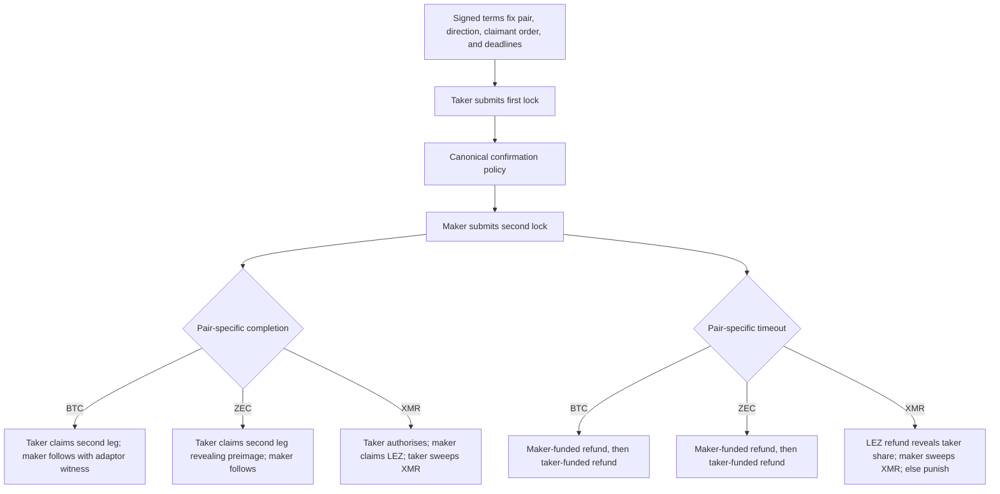
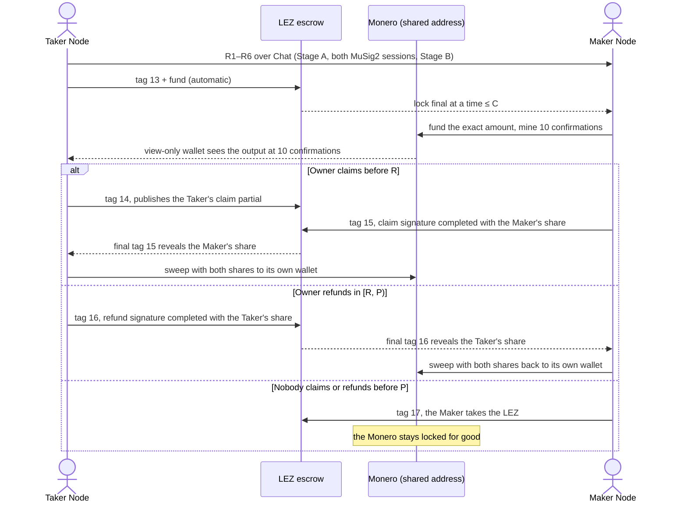

# Per-leg protocol design and atomicity argument

Status: review candidate; cryptographic vectors, calibrated parameters, and LEZ
sequencer reproducers remain executable entry gates — 2026-07-11; the XMR–LEZ
section rewritten on 2026-11-14 to what the tree implements

This design follows the live RFP-003 and accepted Gateway proposal #112. It uses
published constructions rather than inventing cryptography: BIP-340/BIP-341 for
BTC, with adaptor properties mapped against Aumayr et al. and Fournier in
[ADR 0050](../architecture/0050-map-btc-adaptor-construction-to-security-properties.md),
the h4sh3d/COMIT construction for XMR (secp256k1 adaptor signatures on LEZ and
a cross-curve DLEQ proof to the Monero key, [below](#xmrlez)), and BIP-199 plus
ZIP-203 for transparent ZEC.

## Common negotiated transcript

Before either lock, both parties sign and persist a transcript containing:

- protocol/version, swap ID, pair, supported direction, networks, amounts/assets;
- role keys, destinations, exact scripts/program commitments and expected outputs;
- adaptor point or SHA-256 digest, plus every proof needed before funding;
- confirmation/reorg policy, typed refund schedule and conservative safety bounds;
- fee/expiry policy and immutable transaction-template commitments; and
- transcript hash binding every later message and on-chain observation.

Discovery and Chat may transport this transcript but cannot alter it. The first
lock is not submitted until both parties have all recovery material required for
their current stage. The maker's second lock is forbidden until the first lock is
canonical at the negotiated policy.

## BTC–LEZ

The Bitcoin output is P2TR. Its cooperative claim uses a BIP-340 adaptor
signature and Taproot key path. ADR 0009 commits a CSV refund tapleaf for the
Bitcoin funder. The completed signature and retained adaptor pre-signature are
the inputs to witness extraction; accepted signature bytes on LEZ remain
protected by the sequencer reproducer gate.

For `TakerSellsForeign`, the taker funds the longer Bitcoin output, then the maker
funds shorter LEZ escrow. The taker claims LEZ first with the isolated
witness-bearing authorization; the maker extracts the adaptor witness and
completes the Bitcoin key-path claim. For `TakerSellsLez`, the taker funds longer
LEZ escrow and the maker funds shorter BTC. The taker completes the Bitcoin
key-path claim first; its canonical signature reveals the witness with which the
maker claims LEZ.

Security claims rely on the reviewed adaptor construction's aEUF-CMA security,
pre-signature adaptability, and witness extractability. A forged pre-signature,
wrong sighash/output, non-canonical scalar, changed signature bytes, or mismatched
Taproot commitment is terminal invalid evidence—not a retryable observation.

## XMR–LEZ

This section describes the Monero swap as the tree implements it and as it
runs on the Docker devnet: an offline Monero regtest chain beside the LEZ
v0.2.4 devnet chain
([`deploy/README.md`](../../deploy/README.md#monero-lez_monero1)). The runs that
pass, and every limit, are listed in the
[traceability matrix](../requirements-traceability.md) (F3).

### Construction, and why it is not "Ed25519 adaptor signatures"

The requirement (RFP F3) reads "Ed25519 adaptor signatures". That is **not**
what is built. Monero has no scripts and no timelocks, so the conditional
payment cannot be expressed on Monero; it lives on the scriptable chain, LEZ,
whose transactions are signed with BIP-340 Schnorr signatures on secp256k1.
The construction is therefore:

- **secp256k1 adaptor signatures on LEZ.** Two two-party MuSig2 adaptor
  signatures (`musig2 =0.4.1` through `lez-adaptor-signature`, the crate the
  Bitcoin pair uses), one per session: the *claim* session signs the LEZ claim
  (tag 15) with the Maker's Monero share as adaptor secret, the *refund* session
  signs the LEZ refund (tag 16) with the Taker's Monero share as adaptor secret
  (`crates/xmr-swap-sdk/src/agreement_v1.rs`, the two `AdaptorSessionContext`s).
  Completing either signature on LEZ publishes that share.
- **A cross-curve DLEQ proof per share.** Each role's Monero spend-key share is
  a scalar below 2^252, the same integer on both curves
  (`CrossCurveScalar`). A proof from `sigma_fun =0.9.0`
  (`ext::dl_secp256k1_ed25519_eq`) shows that the secp256k1 point used as the
  session's adaptor point and the Ed25519 point used as the Monero public spend
  share have the same discrete logarithm (`crates/xmr-swap-sdk/src/cross_curve.rs`).
- **A plain Monero address.** Its public spend key is the sum of the two
  Ed25519 shares and its view key is shared, so the Maker's Monero output needs
  no Monero-side signature scheme: whoever learns the other party's share adds
  it to its own and holds the full spend key (`ReconstructedMoneroSpendKey`,
  which checks the result opens the agreed address).

This is the standard construction for Monero swaps: the h4sh3d paper
([eprint 2020/1126](https://eprint.iacr.org/2020/1126)) and COMIT's
`xmr-btc-swap` (pinned commit `dc6ba84…`, referenced below), where the
scriptable chain is Bitcoin and the adaptor signatures are ECDSA; here the
scriptable chain is LEZ and the adaptor signatures are BIP-340 MuSig2. The
DLEQ proof is `sigma_fun`'s with BIP-341's NUMS point on secp256k1 and Monero's
`H` on Ed25519 as Pedersen generators, the generators of COMIT's archived
`cross-curve-dleq` and of `eigenwallet/core`, the fork that continues COMIT's
swap; the
pinned `xmr-btc-swap` passes the standard basepoints instead, so its proofs and
these do not verify across. [The SDK guide](../sdk-lez-xmr.md#the-dleq-proof-and-key-share-recovery)
says what the cross-check shows. No third-party vectors exist for this construction;
`crates/xmr-swap-sdk/tests/vectors/` holds **self-generated regression
vectors** (deterministic inputs run once through the pinned crates), which pin
today's bytes and show no agreement with another implementation
(`crates/xmr-swap-sdk/tests/cross_curve_vectors.rs` says how they are made).
The construction has had no third-party review.

### One direction

Only `TakerSellsLez`: the Taker sells LEZ and locks first, the Maker sells XMR
and funds Monero second. The SDK keeps the other direction only to refuse it
(`XmrSwapDirectionV1::TakerSellsXmr`), and the Maker CLI refuses a Monero route
in any other direction. In the refused direction the Taker sells XMR and
would fund the shared Monero address first; if the Maker then never locked
LEZ, nothing on either chain would give the Taker its Monero back (there is no
LEZ escrow to refund from yet, and a Monero output has no time lock), and this
construction has no pre-signed Monero refund to close that gap
([ADR 0217](../architecture/0217-xmr-taker-sells-lez-deviates-from-the-common-flow.md#decision)).

This order (the Maker holds the completing secret and claims LEZ first; the Taker's LEZ refund is the only refund) departs from the common flow of BTC and ZEC; [ADR 0217](../architecture/0217-xmr-taker-sells-lez-deviates-from-the-common-flow.md) states why, and why it is safe.

### Keys

Fresh for every swap, in each role's per-swap role root: both session keys
(claim, refund), the Monero spend-key share and its DLEQ proof; on the Taker
also its agreement key and the **private view key**, which the Taker generates
and hands to the Maker in the first Chat round. Long-lived: the Maker's
agreement key, which is its Chat/Delivery signing key (so the Taker can check
that Stage A is signed by the offer's Maker), and each Node's LEZ owner account
(its signer). The view key crossing Chat is a stated limit: it opens only the
incoming outputs of this swap's one-time address, which both parties must
watch anyway.

### Take-time agreement: six Chat rounds

The Taker calls, the Maker answers (`crates/taker-node/src/taker_service/xmr_dynamic.rs`,
`crates/maker-node/src/xmr_reserve.rs`, `crates/maker-node/src/xmr_chat.rs`).
Nothing is sent to either chain before the sixth round.

| # | Method | Taker → Maker | Maker → Taker |
|---|---|---|---|
| R1 | `xmr_reserve_v1` | its public role packet (keys, Monero share point, DLEQ proof) and the per-swap private view key | its packet, the unsigned Stage A, its BIP-340 Stage-A signature, the window anchor (the Maker Node's clock), monerod's genesis, the restore height (its monerod tip), the owner nonce the punish message is planned with (always 0) |
| R2 | `xmr_chat_stage_a_v1` | the dual-signed Stage A | the reservation and the agreement commitment |
| R3 | `xmr_ceremony_reserve_v1` | nonce commitments for both sessions | its nonce commitments |
| R4 | `xmr_ceremony_nonce_v1` | public nonces for both sessions | its nonces and its partial signatures for both sessions |
| R5 | `xmr_ceremony_partial_v1` | the refund partial **only**, the unsigned Stage B, its Stage-B signature | the refund pre-signature, its Stage-B signature |
| R6 | `xmr_chat_activate_v1` | the dual-signed Stage B | the activation commitment; the Maker registers the swap's actor |

Before countersigning (R2) the Taker recomputes Stage A itself with the same
pinned, chain-free planner (`lez-v02-xmr-stage-a-plan`) from the offer, its own
facts and **its own** window offsets applied to the Maker's anchor, and refuses
anything but byte equality; it also refuses an anchor more than 120 s from its
own clock, another monerod genesis, a restore height above its own monerod tip
plus 3, and a Maker packet whose agreement key is not the offer's Maker
identity (`check_xmr_taker_role`, `crates/xmr-reference-actor/src/reserve.rs`).
Stage A commits the swap's amounts, both packets, the shared Monero address,
the three windows and the exact LEZ messages of the claim, the refund and the
punish. The Taker **withholds its claim partial**: Stage B and the LEZ escrow
carry only a commitment to it, and the Taker publishes it on LEZ (tag 14) only
when its owner claims. An unactivated reservation lapses after 900 s. The
Maker answers a resent identical round as a replay (`was_replay`).

### The escrow: tags 13–17 and three windows

Five instructions of the deployed LEZ v0.2 escrow program serve Monero
(`compat/lez-v0.2-provisional/escrow/src/lib.rs`), appended after tags 0–12 so
the existing instruction bytes are unchanged:

| Tag | Instruction | Signed by | Valid (LEZ consensus time) | From escrow state |
|---|---|---|---|---|
| 13 | `InitializeNativeXmr` | the Taker's owner account | before R | new; then funded by the existing native fund instruction, a second transaction |
| 14 | `AuthorizeNativeXmrClaim` | the Taker's owner account; publishes the Taker's claim partial, checked against the committed commitment | before R | Funded → XmrClaimAuthorized |
| 15 | `ClaimNativeXmr` | the claim aggregate authority (per swap); LEZ to the Maker | before R | XmrClaimAuthorized → Claimed |
| 16 | `RefundNativeXmr` | the refund aggregate authority (per swap); LEZ back to the Taker | from R, before P | Funded or XmrClaimAuthorized → Refunded |
| 17 | `PunishNativeXmr` | the Maker's owner account; LEZ to the Maker | from P | Funded or XmrClaimAuthorized → Claimed |

The three windows are fixed in Stage A as the Maker's anchor plus offsets both
roles configure alike (`funding_cutoff_seconds`, `refund_seconds`,
`punish_seconds` in the role configuration):

- **C, the Maker's funding cutoff** (not on chain). The Maker funds Monero only
  if the Taker's lock is final at a LEZ consensus time no later than C, and only
  from a drive that starts before C by the wall clock and reads the finalized
  LEZ clock (which runs behind it) still before C
  (`crates/maker-node/src/bin/xmr-maker-actor.rs`, `derive_status` and
  `drive_once`). The funding tool runs after that check, so the transfer can
  leave after C: by the tool's own run time (in a desk run of 2026-11-16,
  20261116T010314Z, the transfer was handed to the wallet-rpc 0.3 s before C and
  reached monerod's pool 0.4 s after it), at most the two-minute timeout of
  the Maker's Monero effect tools (`MONERO_EFFECT_TIMEOUT`). That is by design: only the Maker enforces C, and only for
  its own sake. The Taker takes the exact output at 10 confirmations whenever
  it appears before R, authorises its claim (tag 14) only before R by its own
  clock, and the escrow admits tags 14 and 15 only before R by block time, so
  a late funding shortens only the Maker's claim window (at most those 120 s
  of the (R − C)/2 from C to R − (R − C)/2, 200 s on every devnet profile);
  the Taker's refund window [R, P) is untouched.
- **R, the refund time.** Tags 13–15 are valid before R; tag 16 from R.
  The Maker claims (tag 15) only on a tag 14 it sees final before
  R − (R − C)/2, so its claim lands before R. A Maker that does not act within
  its claim window forfeits it and the swap falls back to the Taker's refund.
- **P, the punish time.** Tag 16 is valid before P; tag 17 from P.

The SDK requires R − C and P − R of at least 10 s on regtest. The devnet
derives the windows in `deploy/scripts/gen-config.sh`, in seconds after the
take, from the LEZ step S and stall T (20 s and 40 s by default), the
profile's Bitcoin Maker lock cutoff B and margin M, a Maker actor drive
counted at 80 s and the 20 s the ten Monero confirmations take on regtest:

- C = max(B + 20, 60 + 3 × 80 + 20 = 320): a take and three of the Maker's
  drives for the second of two swaps taken one after the other, plus the depth;
- R = C + 2 × (20 + S + 2 × 80): each half of R − C holds the depth, a LEZ step
  and two of the Maker's drives (measured under three-lane devnet load);
- P = R + S + T + M + 2 × 80.

With the defaults, R − C = 400 s on every profile. `fast` (B = 240 s,
M = 60 s), which every Monero scenario runs on, gives C, R, P = +320, +720,
+1000 s and a refund window P − R of 280 s; `refund` (B = 2S + 20 + T = 100 s,
M = 15 s) +320, +720, +955 s and 235 s; `local` (B = 1800 s, M = 300 s)
+1820, +2220, +2740 s and 520 s.
The Monero output must have 10 confirmations.

### Sequence

- **Happy.** The Taker Node locks by itself right after the take (tag 13 and
  the fund, two LEZ transactions). The Maker Node funds the shared address from
  its role wallet and mines its 10 regtest confirmations. The Taker Node watches
  the address with a per-swap view-only wallet and, once the exact output has
  10 confirmations and is unlocked, offers `claim`. On the owner's claim it sends
  tag 14. The Maker Node aggregates the claim pre-signature from the published
  partial, completes it with its Monero share and sends tag 15. The Taker Node
  extracts the Maker's share from the final tag-15 signature, checks it against
  the Maker's DLEQ proof, adds its own share, sweeps the output to its role
  wallet and mines 10 confirmations; it reports `completed` once it sees the
  swept output.
- **Refund.** In [R, P) the Taker Node sends tag 16 by itself (or on its
  owner's refund, see below); the Maker Node
  extracts the Taker's share from it and sweeps its Monero back. A Taker that
  sent tag 14 and saw no tag 15 by R refunds the same way (the escrow refunds
  from XmrClaimAuthorized).
- **No Monero.** If the Taker's lock is not final by C, or the Maker does not
  fund, the Maker's actor ends `expired` with nothing of its own at stake, and
  the Taker refunds from R.

### PUNISH: a Taker that does not act before P loses its LEZ

**If the Taker neither completes (tag 14 and the Maker's tag 15) nor refunds
(tag 16) before the punish time P, the Maker can take the LEZ with tag 17, and
the Maker's Monero stays locked in the shared address for good.** Spending it
needs both shares; the Maker learns the Taker's share only from a tag 16, the
Taker learns the Maker's only from a tag 15, and after a tag 17 neither can
ever be sent. This is the COMIT punish branch, kept as designed: without it a
Taker that disappears would keep the Maker's Monero and its own LEZ locked
forever; with it the Maker gets the LEZ instead. On the devnet's `fast`
profile the refund window [R, P) is 280 s (P − R above).

- The escrow allows tag 17 from Funded too, with no condition on Monero: a
  Maker that never funded Monero, running other software than this
  repository's Maker Node, can also take the LEZ from P (threat TM-0031). The
  reference Maker Node punishes only a swap whose Monero funding it invoked
  (an unfunded swap ends `expired`). A Taker must refund before P in every
  case, whether or not Monero was funded.
- **The Taker Node refunds by itself.** From R by the finalized LEZ time, on
  a funded escrow the Maker has not claimed (funded with Monero or not), its
  supervisor sends tag 16 with no owner's command on its next sweep
  (`--observer-sweep-seconds`, 3 s on the devnet's `fast` and `refund`
  profiles) and sends it again until it is final or LEZ time reaches P. The
  owner's `taker_swap_refund_v1` (`lez-taker-cli swap refund`) is still
  offered from R (`available_action: "refund"`, actor phase
  `refund_available`); `initiation.xmr_automatic_refund: false` leaves the
  refund to it alone. A Taker Node that is down through [R, P) loses the LEZ.
- **The Taker Node warns.** From R + (P − R)/2 (R + 140 s on `fast`) a swap
  whose escrow is funded and not yet refunded is
  `attention_required` with `attention_reason: "refund_window_closing"` (the CLI
  prints "the refund window is half over: refund now, or from the punish time
  the Maker takes your LEZ and the Monero stays locked"); from R a swap whose
  tag 14 the Maker did not answer reads `xmr_maker_did_not_claim`; from P the
  swap is `punished`, a terminal state, actor phase `punish_open`, and no
  action
  (`crates/taker-node/src/taker_service/xmr_supervisor.rs`, `xmr_taker_view`).
  Nothing outside the owner's own polling delivers the warning.

**What the punish message binds.** Stage A commits the exact LEZ messages of
the claim, the refund and the punish. The claim and the refund are signed by
per-swap aggregate authority accounts that sign nothing else, so their
messages, nonce included, are known at take time; the MuSig2 sessions sign
exactly those hashes and the finalized observers check tags 15 and 16 against
them. The punish is signed by the Maker's LEZ owner account, which signs other
transactions (other swaps, other pairs) between the take and P, so its nonce at
P cannot be known when Stage A is signed. Stage A therefore commits the punish
message at nonce 0, and the punish is held to everything **but the nonce**: the
sidecar rebuilds the message from the agreed terms at the transaction's own
nonce and requires equality (`validate_prepared_native_xmr_punish_v3`,
`compat/lez-v0_2-sidecar/src/native_prepare.rs`), and the finalized check
compares program, instruction and swap id, the ordered accounts and the signer,
not the committed hash (`crates/lez-bridge-protocol/src/xmr_v3.rs`). The escrow
guest itself authorises tag 17 by its signer, accounts and the P window. In
`xmr-punish` (run `20261114T083421Z`) the Maker owner signed tag 17 at nonce 1.

### Limits of what is built

- Regtest and Stagenet. The role configuration takes `accelerated-regtest`
  or `public-stagenet`, and refuses mainnet and testnet; only Regtest
  wallet effects mine, by a capability that exists for Regtest alone. The
  Nodes completed, refunded and punished a swap on Stagenet on 2026-11-21
  ([Stagenet guide](../monero-stagenet-guide.md#the-node-driven-run-of-2026-11-21));
  no Node has run on Monero testnet or mainnet.
- The Taker's claim partial is withheld, not verifiably encrypted (the SDK's
  own note on `commit_taker_claim_partial`; threat TM-0019): a Taker can lock,
  let the Maker fund, and never authorise. The Maker then gets its Monero back
  only if the Taker refunds; otherwise the punish branch applies.
- At sweep time each role hands the reconstructed full spend key to its own
  `monero-wallet-rpc` (`generate_from_keys`), and the swept wallet file stays on
  that wallet-rpc's disk; one wallet-rpc per role is trusted, on loopback only.
- The Monero RPC client `monero-rpc 0.5.1` has known residuals the adapter
  documents (`crates/xmr-monero-adapter/src/lib.rs`): no response-body limit
  before decoding, a `get_block` that can panic on a malformed block, a
  single-header call that drops the daemon's untrusted flag, and a view-only
  wallet's `spent=false` that is not proof of unspent.

The operational limits (nonce coordination, crash windows, manual recovery)
are in the traceability matrix, row F3.

## Transparent ZEC–LEZ

The per-swap preparation generates a 32-byte preimage, commits
`SHA256(preimage)` in both locks, and gives the preimage to the taker's half
only; the maker's Node and actor refuse material that carries one. The prepared ZEC setup is single-operator: the preparation ceremony (`zec-provision.sh`, `local_poc.rs`) signs the template agreement with both roles' keys and holds both halves, the preimage included, while it runs. It is safe only where the preparer is trusted by the Taker (a devnet, a Testnet acceptance run by one owner). Node-side take-time preparation, in which the Taker's Node creates the secret and each Node its own Zcash key, is tracked in issue #162 for M5.
The Zcash transparent output follows BIP-199 with `OP_SHA256` and a consensus
timelock refund branch; under the Taker-reveals-first profiles its claim branch
starts with `OP_SIZE 32 OP_EQUALVERIFY`, so only a 32-byte preimage, the size
the LEZ escrow's `claim_native` takes, can claim the Zcash; the LEZ escrow mirrors the hashlock. Both directions
follow the order BTC follows
([ADR 0216](../architecture/0216-zec-taker-reveals-first-in-both-directions.md)):
the taker locks first, claims the maker-funded leg first and so reveals the
preimage; the maker observes the claim canonically, extracts the preimage and
claims the taker-funded leg. For `TakerSellsForeign` the taker funds ZEC,
the maker funds LEZ, and the taker reveals on LEZ. For `TakerSellsLez` the
taker funds LEZ, the maker funds ZEC, and the taker reveals on ZEC; it claims
only while the maker's funding is at the profile's depth, the Zcash refund
height is more than the profile's reveal margin away, and the LEZ refund
leaves the maker its follow-up margin.

If no preimage is published, the maker-funded leg refunds first: the LEZ
refund in `TakerSellsForeign`, the Zcash refund in `TakerSellsLez`. The
taker-funded leg refunds later by the documented margin. `TakerSellsForeign`
keeps RFP F4's chain order (LEZ refund first); `TakerSellsLez` deviates from
it, because with the LEZ refund first the maker would have to hold the
preimage while the taker's LEZ is locked, and could claim it without funding
ZEC. `nExpiryHeight` is transaction-liveness policy, not the HTLC
refund condition: builders must leave enough inclusion room and recreate an
expired unmined transaction without changing the committed HTLC terms.

An ECDSA adaptor-signature variant remains a possible follow-on. It is outside
the transparent-pool HTLC baseline and this milestone's implementation scope.

The transparent privacy posture is explicit: amounts, addresses, script branches,
and timing are public. Shield-after-swap is a separate user action, never an
atomicity property.

## Atomicity argument and failure partition

Assume canonical chain validation, unforgeable signatures/hashes, sound DLEQ,
durably available recovery material, and—on deadline-bearing paths—a safety
margin large enough for the follow-up claimant to observe the revealing claim
and submit before the earlier refund path can defeat completion.

1. Before the taker lock, neither party has funds at risk.
2. With only the taker lock, the maker cannot receive value without funding;
   the taker eventually uses its negotiated refund path. The maker's claim of
   the taker-funded leg needs a secret only the taker holds, and the taker
   releases it only by claiming the maker-funded leg (BTC adaptor witness, ZEC
   preimage, in both directions) or, for XMR, by publishing the Tag 14
   authorization after the Monero funding is confirmed. Before the maker
   funds, there is nothing for the taker to claim, so the secret stays with
   the taker.
3. With both locks, the construction-specific first claimant receives value only
   by publishing pair claim evidence. Witness extractability/hash preimage
   disclosure gives the counterparty the exclusive missing input for the
   follow-up claim.
4. For BTC and ZEC, in both directions, the maker-funded refund matures before
   the taker-funded refund (for ZEC `TakerSellsLez` this departs from RFP F4;
   see ADR 0216). For XMR, the taker's LEZ refund (tag 16) in [R, P)
   publishes the taker's share, which completes the maker's recovery of the
   maker-funded Monero output; a LEZ claim (tag 15) is valid only before R. If
   neither happens before P, the maker takes the LEZ (tag 17) and the Monero
   stays locked: that terminal path is neither "both claimed" nor "both
   recovered", and it is the taker's loss by design ([PUNISH](#punish-a-taker-that-does-not-act-before-p-loses-its-lez)).
5. A confirmation regression suspends claims and pins the committed transaction;
   refunds remain available. A pre-maker removed lock may be explicitly replaced.

Thus every permitted terminal path is both claimed or both recovered, except
the XMR punish path above. The period
after the revealing claim but before the follow-up claim is safe only under the
stated evidence extraction, chain-observation, persistence, and
calibrated-margin assumptions; those are named test and audit gates rather than
hidden guarantees.

## Primary references and executable gates

- [BIP-340](https://bips.dev/340/), [BIP-341](https://bips.dev/341/), and
  [BIP-327](https://bips.dev/327/);
- [Aumayr et al., *Generalized Channels from Limited Blockchain Scripts and
  Adaptor Signatures*](https://www.iacr.org/archive/asiacrypt2021/130900239/130900239.pdf)
  and [Fournier, *One-Time Verifiably Encrypted Signatures*](https://github.com/LLFourn/one-time-VES/blob/2ddc7ca7bc48c7a91b8a596e12a759a666a14deb/main.pdf);
  [ADR 0050](../architecture/0050-map-btc-adaptor-construction-to-security-properties.md)
  states how these properties are used and the limits of that mapping;
  the test-reference correction GW-M3-001 was [accepted by Logos](https://github.com/logos-co/rfp/issues/123#issuecomment-5781178140)
  on 22 September 2026; this does not approve M3 or the full security construction;
- [h4sh3d paper](https://eprint.iacr.org/2020/1126) and pinned
  [COMIT reference](https://github.com/comit-network/xmr-btc-swap/commit/dc6ba84bbb1fe5ecc69581fec7dd8529567c4e32);
- [BIP-199](https://bips.dev/199/) and
  [ZIP-203](https://zips.z.cash/zip-0203); and
- pinned LEZ source/standalone-sequencer validity and signature-byte reproducers.
