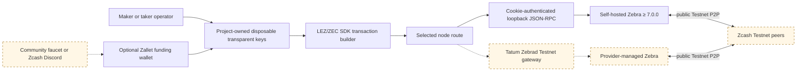

# Zcash public-testnet node, wallet, and funding guide

Status (2026-11-11): the acceptance lane exists — runner, evidence bundle and
a manual/weekly workflow — and its preflight runs against public Zcash
Testnet. Zcash Testnet moved to NU7 (consensus branch `77190ad9`) at height
4,465,026 on 2026-10-04; the swap engine now signs for it (librustzcash 0.31,
agreement profile `public-testnet-v2`) and a Testnet corridor can be
provisioned from an owner-funded transparent key. **No public-testnet swap
has run yet:** the funder key holds no TAZ and no keyed route exists
([what is missing](#what-blocks-a-public-corridor)).

This guide separates what an operator can configure today from what is
missing. It does not claim a passing public-testnet swap. The primary route is
a self-hosted Zebra JSON-RPC endpoint. No Zcash Foundation-operated public
Zebra JSON-RPC service was found. Tatum's Zebrad Testnet gateway is the one
public-provider route the actor accepts; it is not interchangeable with
lightwalletd gRPC.



## Proven facts and current blockers

- Zcash Testnet today (measured 2026-11-11 on Tatum's gateway): Zebra
  `/Zebra:7.0.0/`, tip ~4,607,100, current branch NU7 `77190ad9` (activated at
  4,465,026), NU6.3 `37a5165b` at 4,134,000 and NU6.2 `5437f330` at 4,052,000
  before it. NU7 coinbases are v6 transactions; ordinary v5 transactions are
  still mined, and they commit to the current branch id. Blocks came every
  22.7 s on average since NU7 (25.1 s over its first 274 blocks, 29.3 s over
  the latest 1,000), not 75 s; min-difficulty runs are far faster (1,000 blocks
  in 3,922 s just before NU7).
- A self-hosted Testnet Zebra must be a release that knows NU7's Testnet
  activation (the gateway runs 7.0.0). Use the signed release or an exact tag;
  do not follow a moving branch. Zebra 6.0.0, which this guide once named,
  stops at NU6.3.
- Zebra is the consensus oracle and broadcaster. librustzcash construction or
  parser success alone is not consensus evidence.
- The isolated regtest harness (`tests/e2e/zebra/Dockerfile`) deliberately pins
  a different, digest-pinned Zebra than the public-testnet guidance above: it
  copies `zebrad` out of `zfnd/zebra:5.2.0` at a fixed digest. Regtest consensus
  is what that harness tests, so it moves on its own schedule. Public-testnet
  work follows the ≥ 7.0.0 guidance.
- Tatum documents a dedicated Zebrad JSON-RPC endpoint at
  `https://zcash-testnet-zebrad.gateway.tatum.io`, API-key authentication, a
  free Testnet key, and a separately monitored Testnet Zebrad status component.
  This is a third-party authoritative-node route, not independent consensus
  proof or an official Zcash Foundation service. See Tatum's
  [Zebrad gateway announcement](https://docs.tatum.io/changelog/zcash-zebrad-rpc-support-added),
  [Zcash authentication guidance](https://tatum.io/chain/zcash), and
  [status page](https://status.tatum.io/).
- Zallet `v0.1.0-alpha.4` can create a testnet account, expose a transparent
  P2PKH receiver, and send ordinary transparent funds. It cannot export its
  HD-derived transparent private keys or sign arbitrary raw/PCZT HTLC
  transactions. Its `z_exportkey` support is Sapling-only, while raw create,
  fund, and sign replacements remain unfinished. See the
  [Zallet release](https://github.com/zcash/zallet/releases/tag/v0.1.0-alpha.4),
  [export-key implementation](https://github.com/zcash/zallet/blob/v0.1.0-alpha.4/zallet/src/components/json_rpc/methods/export_key.rs),
  and [RPC migration table](https://github.com/zcash/zallet/blob/main/book/src/zcashd/json_rpc.md).
- Therefore the corridor still needs project-owned disposable transparent key
  custody and signing. Zallet is optional funding infrastructure, not the swap
  signer. Never import production seeds to bridge this gap.
- Zallet alpha.4 documents NU6.2 support, while Zebra 6.0 schedules NU6.3 at
  Testnet height 4,134,000. Treat Zallet as fail-closed until its reported sync
  and branch compatibility are verified for the current tip.

## Isolated self-hosted Zebra route

### Prerequisites

- Rust toolchain capable of building the exact Zebra tag, or its signed release
  binary.
- About 16 GB of state today (the gateway's Zebra reports `size_on_disk`
  15.6 GB for Testnet; Zebra has no pruning, checkpoint sync only shortens
  verification) and, by our guess, several hours of initial sync. See the official
  [requirements](https://zebra.zfnd.org/user/requirements.html) and
  [troubleshooting guide](https://zebra.zfnd.org/user/troubleshooting.html).
- Unique, owner-controlled state, cookie, log, and configuration directories.
- Caller-selected unused loopback RPC and P2P ports. Do not assume the example
  ports are free and do not overlap repository Regtest/Docker runs.

Install the pinned source build if a verified binary is not used:

```sh
cargo install --locked --git https://github.com/ZcashFoundation/zebra \
  --tag v7.0.0 zebrad   # the release Tatum's gateway runs; any later release that keeps NU7's Testnet activation
```

Generate a configuration into a run-specific directory:

```sh
export RUN_ID="manual-zec-testnet-a"
export RUN_DIR="/tmp/lez-atomic-swaps-${RUN_ID}"
install -d -m 700 "$RUN_DIR/state" "$RUN_DIR/cookie"
zebrad generate -o "$RUN_DIR/zebrad.toml"
```

Set these supported fields in `zebrad.toml`, choosing verified-free loopback
ports rather than copying a concurrently used value:

```toml
[network]
network = "Testnet"
listen_addr = "127.0.0.1:18233"

[state]
cache_dir = "/tmp/lez-atomic-swaps-manual-zec-testnet-a/state"

[rpc]
listen_addr = "127.0.0.1:18232"
cookie_dir = "/tmp/lez-atomic-swaps-manual-zec-testnet-a/cookie"
enable_cookie_auth = true
```

Do not customize public Testnet consensus parameters. Start with:

```sh
zebrad -c "$RUN_DIR/zebrad.toml" start
```

The official [Zebra Book](https://zebra.zfnd.org/) documents configuration,
startup, and cookie-authenticated curl. RPC is disabled until `listen_addr` is
set. Keep it on loopback: a public bind permits untrusted state queries and
transaction submission.

### Required preflight

Use the cookie file without printing it or enabling shell tracing. Query
`getblockchaininfo` and require:

- `chain` is `test`;
- `verificationprogress` is effectively synchronized;
- `blocks` is close to `estimatedheight`; and
- `consensus.next_block` identifies the epoch used to build and sign the next
  transaction.

Never hardcode the branch ID for a long-running test. NU6.2 used branch
`0x5437f330`, NU6.3 `0x37a5165b`, and NU7 — current on Testnet — `0x77190ad9`. Re-query immediately before signing and
rebuild/re-sign if the epoch changes. The authoritative branch mapping is in
[`zcash_protocol`](https://github.com/zcash/librustzcash/blob/main/components/zcash_protocol/src/consensus.rs).

The manual corridor will require at least `getblockchaininfo`, `getblockcount`,
`getblock`, `getrawtransaction`, `gettxout`, and `sendrawtransaction`. Confirm
the exact surface with `rpc.discover`; see Zebra's
[RPC trait](https://zebra.zfnd.org/internal/zebra_rpc/methods/trait.RpcServer.html).

## Public Zebrad provider route

Create a dedicated Testnet API key in Tatum and keep it in an owner-readable
credential source. Without a key the gateway answers too (measured
2026-11-11), but admits five requests a minute (HTTP 429, `retry-after: 60`)
and refuses JSON-RPC batches (HTTP 402) — enough for the lane's preflight,
far too little for a swap. The documented endpoint is:

```text
https://zcash-testnet-zebrad.gateway.tatum.io
```

Use the recommended `x-api-key` header. Never place the key in a URL, source,
shell history, test snapshot, debug output, or recording. Before enabling a
swap, query `getblockchaininfo` and enforce the same Testnet, sync, tip, and
`consensus.next_block` checks as the self-hosted route. Then smoke every method
the actor needs: `getblockcount`, `getblockhash`, `getblock`,
`getrawtransaction`, `getrawmempool`, `gettxout`, and `sendrawtransaction`.
Method discovery and unauthenticated availability alone are not sufficient.

The actor consumes this route today. `ZebraRouteConfig::TatumTestnetXApiKey`
(`crates/zec-reference-actor/src/config.rs`) carries the exact origin and an
owner-only `api_key_file`; the actor builds the client with
`HttpZebraRpcConfig::public_https(..).with_public_api_key(..)`
(`crates/zec-reference-actor/src/command.rs`), which installs the key as a
fixed sensitive `x-api-key` header. The two auth shapes cannot be crossed:
`with_cookie_credentials` on a public endpoint is refused with
`CookieAuthOnPublicEndpoint`, and `public_https` rejects any endpoint other
than the exact Tatum Testnet origin — URL credentials, paths, queries,
fragments, alternate providers and explicit ports included.

The transport still owes nothing to the operator beyond the key, but the
operational rules stand: bounded response bodies, time and concurrency, no
automatic retry of `sendrawtransaction` after an unknown outcome, and the same
chain, branch, genesis, block, transaction and stable-tip validation as the
self-hosted route. Where practical, cross-check read evidence against a
self-hosted node; never merge disagreeing observations or silently fail over
between nodes during a state transition.

## Disposable transparent wallet and funds

The swap address is produced by project-owned key custody, which exists. The
actor reads an owner-only `zcash_key_file` (`config.rs`) and loads it through
`SecretKey::from_slice(material.zcash_secret_key())` (`command.rs`); it signs
its own BIP-199 HTLC claim and refund transactions. Record only the `tm...`
address and never log the secret key.

This is what `real_actor_keys_fund_claim_and_refund_through_zebra_consensus`
(`crates/zec-swap-sdk/tests/zebra_regtest.rs`) exercises against a real Zebra:
real actor keys fund the HTLC, and consensus accepts both the claim and the
refund. The `zebra-regtest` CI job runs it on every change.

The official Zcash testnet guide currently points users to Zcash Discord support
or the community `https://faucet.zecpages.com/` faucet; on 2026-11-11 it timed
out, and no other faucet answered from a container (testnet.zecfaucet.com,
zcashfaucet.info, faucet.testnet.z.cash). Transparent TAZ are all the BIP-199
route needs. See the
[official testnet guide](https://zcash.readthedocs.io/en/latest/rtd_pages/testnet_guide.html).
The faucet has no documented current SLA, rate limit, or dispense amount and was
unresponsive during the 2026-07-12 research check. It must never be a required CI
gate. Record any returned transaction ID and independently verify it through the
operator's Zebra node. Keep a separately controlled pre-funded test wallet as a
fallback for scheduled evidence runs.

### Optional Zallet funding wallet

Pin Zallet `v0.1.0-alpha.4`, use the `zallet-zaino` backend, bind its RPC only to
loopback, and point `validator_address` plus `validator_cookie_path` at the
self-hosted Zebra instance. Follow the official
[setup guide](https://github.com/zcash/zallet/blob/v0.1.0-alpha.4/book/src/guide/setup.md)
and pinned
[example configuration](https://github.com/zcash/zallet/blob/v0.1.0-alpha.4/zallet/tests/cmd/example_config.out/zallet.toml).

After full wallet sync, the supported funding flow is:

1. `z_getnewaccount` for a disposable funding account.
2. `z_getaddressforaccount` requesting `sapling` and `p2pkh` receivers.
3. `z_listunifiedreceivers` and extract the `p2pkh` `tm...` receiver.
4. Obtain TAZ at that funding receiver.
5. Use `z_sendmany` with the explicit `AllowFullyTransparent` privacy policy to
   send TAZ to the project-owned swap address.
6. Poll `z_getoperationstatus`/`z_getoperationresult`, then verify the outpoint
   independently with Zebra `gettxout`.

Zallet's database contains cleartext history and viewing material even though
key material uses age encryption. Keep the database, age identity, and mnemonic
owner-only; never rely on the mnemonic to recover standalone keys. Its alpha RPC
is not a production custody boundary.

## Public Testnet acceptance lane

The broad happy/refund/concurrency/restart matrix stays on deterministic
Regtest and the private LEZ devnet. Public Testnet is a smaller acceptance
lane: the ZEC corridors of `deploy/scripts/node-e2e.py`, run against Zcash
Testnet and the official LEZ v0.2 testnet, each leaving an evidence bundle of
public data.

| Piece | What it does |
|---|---|
| `deploy/zec-public-testnet.env` | the lane profile: the agreement profile and the branch, confirmations and refund blocks it pins (a unit test keeps them equal to `profile.rs`), Testnet's genesis, the two routes and their request pacing, block-wait and timeout scaling |
| `deploy/scripts/public-zec-testnet.sh` | preflights each route, runs each scenario × direction on every usable route with `LEZ_ZEC_PUBLIC_TESTNET=1`, looks every Zcash transaction up again on its route and on the other route, records LEZ testnet tips before and after, writes the bundle |
| `deploy/scripts/zec-public-evidence.py` | the preflight, the lookups and the bundle writer/validator (read-only: it refuses `sendrawtransaction` and `generate`) |
| `node-e2e.py` public mode | never mines: a wait for blocks waits for Testnet's own, each ZEC wait is `LEZ_ZEC_TIMEOUT_SCALE` times its devnet length, the route's cookie or key is read from a file per request |
| `.github/workflows/zcash-public-testnet.yml` | manual and weekly: a GitHub-hosted provider preflight, then the corridors on a self-hosted runner labelled `lez-zec-testnet`; the bundle is a 90-day artifact |

Run it from `deploy/` on a host whose Nodes run on the public networks
(docs/testnet-run.md for the LEZ side) with a synced Testnet Zebra on loopback:

```sh
export LEZ_ZEC_SELF_HOSTED_COOKIE_FILE=<Zebra cookie>   # never printed
export LEZ_ZEC_PROVIDER_API_KEY_FILE=<owner-only key file> LEZ_ZEC_PROVIDER_MIN_INTERVAL_SECONDS=1
bash scripts/public-zec-testnet.sh --routes self-hosted,provider \
  --scenarios zec-happy,zec-maker-refund --directions TakerSellsLez \
  --intervention "<any manual step, one flag each>"
bash scripts/public-zec-testnet.sh --routes provider --preflight-only   # the routes alone
```

The bundle (`runtime/zec-public/<stamp>/bundle/`: `evidence.json`,
`SUMMARY.md`, `SHA256SUMS`) holds the source SHA and whether the tree was
dirty, the workflow run, the digests of the Node images (and of any release
files named in `LEZ_ZEC_ARTIFACT_FILES`), per route its kind, origin, Zebra
version, chain, genesis, tip, sync and the current and next consensus
branch, the LEZ sequencer, channel and last block id at the start and the
end, per corridor its route, scenario, direction, swap id, start and end, and
every Zcash transaction with its height, block and confirmations as the route
and the other route see it, every provider error and manual intervention,
and the shielding statement. Its status is `passed`, `failed`, `blocked` or
`preflight`, and its `evidence_kind` is `public-chain-swap` only when a swap
transaction was found on a route that proved itself Testnet by chain *and*
genesis — Zebra reports `test` for Regtest too. The validator refuses a
passed corridor without its funding and claim (or refund) transaction, a
Zcash transaction below the profile's confirmations, a passed run without
artifact digests, any field named like a secret, and any file holding the
contents of a credential file; `coverage.acceptance_complete` needs a happy
and a refund corridor and a complete corridor on each route.

Timing: a happy corridor waits for two LEZ-final effects (the LEZ testnet
finalizes ~50 blocks, about 50 minutes, behind its tip) plus the Zcash
confirmations; a refund corridor waits for the agreement's LEZ refund time
and Zcash refund height. `public-testnet-v2` sizes the Zcash refund for
safety at the fastest pace Testnet has run, not the average (below), so the
Zcash refund opens ~23 hours after funding at today's 22.7 s blocks. Our
estimate, not a measurement: about 2 hours for a happy corridor, about a day
for a refund corridor; a full scheduled run is a day or more on a
self-hosted runner.

### The agreement profile: `public-testnet-v2`

Profiles are immutable per id. `public-testnet-v1` (NU6.2, 192 Zcash refund
blocks) keeps its meaning; `public-testnet-v2` (wire tag 6) is the Testnet
profile since NU7:

| Parameter | v1 | v2 | Why |
|---|---|---|---|
| Branch | NU6.2 `5437f330` | NU7 `77190ad9` | Testnet's chain tip since 4,465,026 |
| LEZ refund delay / margin | 2 h / 2 h | 2 h / 2 h | unchanged |
| Confirmations LEZ / Zcash | 2 / 10 | 2 / 10 | unchanged (10 Zcash blocks ≈ 4 min) |
| Zcash refund blocks | 192 | 3,700 | rule below |
| Expiry delta | 40 | 120 | 50 min at NU7's 25 s target, librustzcash's NU7 default |

The rule: the Zcash refund (the later one) must not open before the LEZ refund
delay plus the margin after funding, at the fastest pace Testnet has run —
`refund blocks × 3.9 s ≥ 2 h + 2 h`. Testnet's min-difficulty rule lets cheap
blocks through: 1,000 blocks took 3,922 s just before NU7. 3,700 × 3.9 s =
14,430 s ≥ 14,400 s. At the 22.7 s average since NU7 the window is ~23 h; v1's
192 blocks were ~73 min at that pace and ~12.5 min at the fastest. The
provisioner states the Zcash refund's earliest time with the same 3.9 s
(`PUBLIC_TESTNET_FASTEST_BLOCK_MILLIS`).

### Provisioning a Testnet corridor

`scripts/zec-provision.sh --zcash-network test` (node-e2e.py calls it in
public mode) builds one corridor under `public-testnet-v2`:

- the route from `LEZ_ZEBRA_URL` and exactly one of `LEZ_ZEBRA_COOKIE_FILE`
  (self-hosted Zebra on loopback) or `LEZ_ZEBRA_API_KEY_FILE` (Tatum), as
  `public-zec-testnet.sh` sets them; chain `test`, genesis `05a60a92…2c38` and
  a chain tip on NU7 are checked before anything else;
- the role keys `maker-zcash.key` and `taker-zcash.key` from
  `LEZ_ZEC_TESTNET_KEY_DIR` (mode 0700, refused inside the repository). The
  Maker's key is also its Delivery identity: install it as the testnet
  stack's `runtime/lez/maker/zcash.key` before the Nodes start;
- the Zcash funder spends an ordinary unspent output of its key, 10 blocks
  deep, found from `LEZ_ZEC_TESTNET_FUNDING_FROM_HEIGHT` (the height of the
  owner's TAZ payment, first run) or from where the last corridor's funder
  output was (`runtime/zec/testnet-funding-from`; its change lands after it);
- a Taker-funded corridor (`TakerSellsForeign`) first pays the Taker's key
  from the Maker's (`zec-local-poc-transfer --zcash-network test`) and waits
  for that payment to be 10 blocks deep;
- the principal is `LEZ_ZEC_TESTNET_PRINCIPAL_ZATOSHIS` (0.01 TAZ in the lane
  profile) against the template's 50,000 LEZ units; fees are 10,000 zatoshis
  per Zcash transaction;
- each actor gets its own copy of the route's credential beside its keys,
  and scans the whole 3,701-block refund window for the counterparty's lock.

Nothing is mined and nothing is broadcast before the actors run, except the
Taker-funding payment. Zebra has no dry-run (`testmempoolaccept` answers
"Method not found" on Zebra 7.0.0), so the first proof that a NU7 spend is
accepted is a real one.

What the lane does not record yet: LEZ transaction ids (node-e2e.py's ZEC
summaries name only Zcash transactions; LEZ effects are visible on the
explorer through the swap's accounts), and an independent LEZ indexer
observation beyond the sequencer's tip.

### What blocks a public corridor

Run on 2026-11-11, the first preflight stopped at the consensus branch:
Testnet's next block is on NU7 (`77190ad9`), the then lane profile's
`public-testnet-v1` signs for NU6.2 (`5437f330`). The bundle of that run is
[`docs/evidence/zcash-public-testnet-20261111-preflight/`](evidence/zcash-public-testnet-20261111-preflight/SUMMARY.md);
it holds no swap. Since then the swap engine:

1. signs for NU6.3 and NU7: `zcash_protocol` 0.11.0, `zcash_primitives`
   0.31.0 and `zcash_transparent` 0.11.0 carry the final ids. Two transparent
   v5 spends mined on Testnet — `a85b0f6a352b9699d4221a93eeadbab457862c4dec2a3ac7ccd0d2f034fc89ea`
   in the NU7 activation block and `d759e629035fc77989d8b3253d16660e5cd3beef33bd8a011ba335d0f44d7bb8`
   in the last NU6.3 block — reproduce their txids and their signatures verify
   under our ZIP-244 hash (`crates/zec-swap-sdk/tests/zcash_testnet_vectors.rs`);
2. has the immutable profile `public-testnet-v2` (above), which the lane
   profile `public-zec-testnet-v2` names;
3. lets the actor's `ConsensusBranchConfig` name `37a5165b` and `77190ad9`;
4. provisions Testnet corridors (above).

What is still missing, all of it the owner's or the host's:

- transparent TAZ at the Maker funder key's `tm…` address (no faucet
  answered). One happy and one refund corridor on each of the two routes,
  `TakerSellsLez`, spend 4 × (0.01 + 0.0001) TAZ from it, about 0.041 TAZ; the
  same four `TakerSellsForeign` corridors add 4 × 0.0103 TAZ of payments to
  the Taker; 0.1 TAZ covers both directions;
- a keyed route: a Tatum Testnet API key as the secret
  `ZCASH_TESTNET_TATUM_API_KEY` (five keyless requests a minute cannot drive a
  corridor), or a synced self-hosted Testnet Zebra ≥ 7.0.0 (~16 GB) and the
  self-hosted runner `lez-zec-testnet`;
- the testnet stack running the Maker under the funder key, with the LEZ
  testnet side services (docs/testnet-run.md) and LEZ funds.

Public Testnet is inherently dependent on peer availability, initial sync,
faucet or pre-funded-wallet availability, activation timing, and organic reorgs.
Keep deterministic Regtest as the required per-commit consensus lane; the
public lane's failures retain their bundle and are never silently ignored.

## Security, privacy, and cleanup

- Transparent sender, recipient, amount, and transaction graph are permanently
  public. Use disposable Testnet identities and never reuse mainnet keys,
  addresses, seeds, cookies, or provider credentials.
- Keep Zebra and Zallet RPC on loopback. Never put cookie contents, mnemonics,
  WIFs, raw private material, or shell traces in CI logs or recordings.
- Testnet TAZ has no monetary value, but credentials and linkage metadata remain
  sensitive.
- Stop Zallet and Zebra before removing only the run-specific directory. Preserve
  the state and evidence directory when a result will support an M2 acceptance
  claim; record its owner, commit, tool versions, and hashes.

## External-resource and flakiness summary

| Resource | Required today | Authority | Flakiness / limitation |
|---|---:|---|---|
| Self-host Zebra ≥ 7.0.0 (NU7 Testnet) | Selected route; ~16 GB state | Local operator; public consensus peers | Initial sync, disk, DNS/P2P, epoch transitions |
| Tatum Testnet Zebrad JSON-RPC | Selected public-provider route; read methods answer (2026-11-11), `sendrawtransaction` untried | Tatum API-key gateway and provider-managed Zebra | Account/key provisioning, quotas, outage, method policy, lag, and provider trust; never substitute generic Zcash RPC or lightwalletd |
| Community faucet | Optional | External community operator | No SLA/current limits; may time out or be depleted |
| Zcash Discord funding request | Optional fallback | External support process | Manual response and availability |
| Zallet alpha.4 | Optional funding wallet only | Local operator | Alpha compatibility; no arbitrary HTLC signing; NU6.3 must be reverified |
| Project transparent signer | Exists (`zcash_key_file`, actor-signed claim and refund) | Independent maker/taker | Signs for NU6.2 (Regtest), NU6.3 and NU7; mined Testnet vectors verify, no NU7 spend broadcast yet |
| Testnet corridor provisioner | Exists (`zec-provision.sh --zcash-network test`) | Maker/taker setup | Needs owner-funded TAZ and a keyed route; untried end to end |
